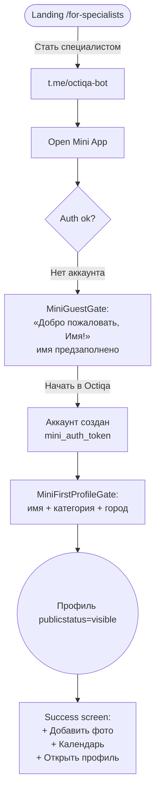
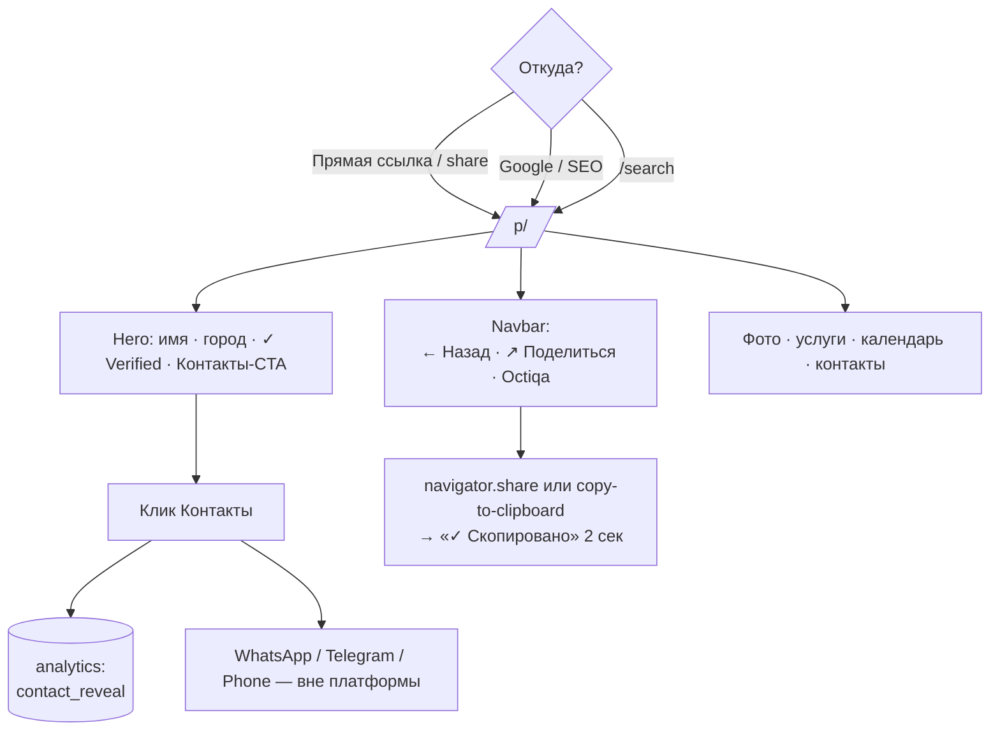

# 📍 Octiqa — как работает сейчас

> **Источник истины** для текущей логики проекта. Обновляется при каждом значимом изменении. Если что-то здесь устарело — это баг.

## TL;DR

Octiqa помогает специалисту управлять занятостью и связывает его с клиентом через публичный профиль `/p/<slug>`.

- **Регистрация:** Telegram Mini App (рекомендуемый путь) или web `/signup` (fallback)
- **Профиль публикуется после Step 1** — не нужно проходить все 5 шагов
- **Управление:** Mini App (Telegram) — основное. Web dashboard — параллельный с migration-banner-нудж'ом «Открыть в Telegram»
- **Подписка:** account-level, trial 30 дней автоматом

---

## 🧑‍🍳 Сценарий специалиста (сегодня)

### Путь A — через Telegram (рекомендуемый, Telegram-first)



1. Открывает `t.me/<bot>` через ссылку с landing `/for-specialists` (Tasks 44, кнопки уже все Telegram-first).
2. Бот предлагает Mini App.
3. `MiniGuestGate` приветствует: **«Добро пожаловать, [Имя]!»** + 3 Benefit-карточки (📅 календарь / 🌐 клиенты / 🔔 уведомления). Имя предзаполнено из `tgUser.first_name + last_name`.
4. Кликает «Начать в Octiqa» → backend создаёт Account по `telegram_user_id`, выдаёт `mini_auth_token` с `expires_at`.
5. `MiniFirstProfileGate` — компактная форма: название, категория (8 чипов или своя), город. Без пароля, без 5-шагового онбординга.
6. Профиль публикуется сразу (`publication_status='visible'`).
7. Success-экран с тремя следующими действиями: добавить фото / заполнить календарь / открыть профиль публично. Можно «Позже».

### Путь B — через web `/signup` (fallback)

```mermaid
flowchart TD
    Signup[/signup<br>username + phone + password/] --> Onb[/dashboard/onboarding/]
    Onb --> Step1[Step 1 Basics:<br>имя + slug + регион + город<br>+ категория (обязательно)]
    Step1 -->|Опубликовать профиль| Pub((Профиль visible))
    Pub --> Banner[Dashboard banner:<br>«Профиль опубликован — дополните»]
    Step1 -.->|или Закрыть| Skip[На dashboard]
    Pub --> Step2[Step 2-5 (опционально):<br>фото, контакты, Telegram, календарь]
```

1. `/signup` — `username` + `phone` + `password`. Phone сразу `phone_verified_at = NOW()`.
2. Авторедирект → `/dashboard/onboarding`.
3. **Step 1**: имя + slug + регион + город + категория. Кнопка **«Опубликовать профиль →»**. После сабмита — `PATCH publication_status='visible'` если статус был `draft`.
4. Steps 2–5 теперь **дополнения**, не обязательны. Nav-кнопка «Закрыть» вместо «Пропустить» когда provider уже создан.
5. На dashboard баннер: **«Профиль опубликован — дополните»** + кнопка «Дополнить →».

### Повседневное использование

| Где | Что доступно |
| --- | --- |
| **Mini App** (`/mini`) | Профили (multi-profile switch только если >1), календарь, аналитика, More (подписка / интеграции / команда / передачи / история / settings) |
| **Web dashboard** (`/dashboard`) | Тот же набор + список профилей, edit, notifications. Параллельный канал. Сверху каждой страницы — `MoveToMiniBanner` с CTA в Mini App (Idea 3 Phase 1) |
| **Telegram bot** | Уведомления о бронях, quick booking текстом/voice, deep-link на привязку профилей и помощников |

**Подписка-индикатор:**
- Бейдж в `MiniTopBar`: `Trial: 23 дн` (серый) / `Trial: 5 дн` (оранжевый при ≤7) / `Истекает: 2 дн` / `Подписка истекла`
- В `MoreScreen` row «Подписка» подзаголовок динамический: «Пробный период · 23 дн осталось» и т.д.

**Settings split** (Mini App → More → Настройки):
- **Обычное** (всегда видно): Аккаунт + ФИО, Публичная страница (showOwnerName / showRelatedProfiles), Telegram primary, Поддержка, Logout
- **Продвинутое** (за toggle): Архив профиля, Передача профиля (transfer_request), Опасная зона (hard-delete)

---

## 🙋 Сценарий клиента (сегодня)



1. Заходит на `/p/<slug>` — через прямую ссылку, поиск Google (SEO via `generateMetadata` + `sitemap.xml`), share-ссылку, или `/search`.
2. **Navbar**: «← Назад», **«↗ Поделиться»** (новая кнопка — Web Share API на мобильных, clipboard fallback), Octiqa logo.
3. **Hero**: фото-аватар, имя, локация, бейдж «✓ Верификация» (если is_verified), CTA «📲 Контакты».
4. Контент: фото-галерея, услуги/цены, **публичный календарь занятости** (зелёный/красный/жёлтый), контакт-кнопки.
5. Клик «Контакты» → `POST /providers/<id>/track-contact` (анонимный analytics_event) → раскрытие links → клик на WhatsApp/Telegram/Phone открывает deep-link.
6. Дальше общение и оплата — **вне Octiqa**.

Регистрация клиента не нужна.

---

## 🏗️ Архитектура

### Где живёт код

| Что | Файл |
| --- | --- |
| **Auth SSOT (web + mini)** | `apps/web/src/lib/auth.ts` |
| **Wire-типы (UI ↔ API)** | `packages/types/src/domain.ts` |
| Mini App вход | `apps/web/src/app/mini/MiniShell.tsx` |
| Гейт нового пользователя | `apps/web/src/app/mini/overlays/MiniGuestGate.tsx` |
| Гейт первого профиля | `apps/web/src/app/mini/overlays/MiniFirstProfileGate.tsx` |
| Mini hooks | `apps/web/src/app/mini/hooks/{useMiniApp,useCalendar,useProviderData}.ts` |
| Mini screens (декомпозированы) | `apps/web/src/app/mini/screens/{Profiles,Calendar,Analytics,More}Screen.tsx` + `more/*Tool.tsx` (Subscription/Integrations/Team/Activity/Settings/Notifications) |
| Migration-баннер | `apps/web/src/components/MoveToMiniBanner.tsx` (показывается в `dashboard/layout.tsx`, скрыт на onboarding) |
| Mini overlays | `apps/web/src/app/mini/overlays/{MiniAddSheet,MiniSwitchSheet,MiniPicker,MiniGuestGate,MiniFirstProfileGate}.tsx` |
| Mini shared | `apps/web/src/app/mini/components/{MiniStyles,MiniTopBar,MiniBottomNav,MiniLoader,EmptyState,NavRow}.tsx` |
| Web onboarding | `apps/web/src/app/dashboard/onboarding/{page,Step1Basics,Step2Photos,Step3Contacts,Step4Telegram,Step5Calendar,_shared,slug}.tsx` |
| Web dashboard pages | `apps/web/src/app/dashboard/{page,settings,subscription,provider,calendar,integrations,notifications,analytics}/...` |
| Public profile | `apps/web/src/app/p/[slug]/ProfileClient.tsx` + `profileHelpers.ts` |
| Visible-viewport hook | `apps/web/src/lib/useVisibleViewport.ts` |
| Link normalization (web) | `apps/web/src/lib/linkUrl.ts` |
| Telegram links / SDK | `apps/web/src/lib/{telegram,telegramLinks}.ts` |
| API auth | `apps/api/src/auth/` |
| API providers | `apps/api/src/providers/` |
| API calendar | `apps/api/src/calendar/` |
| API onboarding (только tracking) | `apps/api/src/onboarding/routes.ts` |
| API telegram bot + mini auth | `apps/api/src/telegram/` |
| API subscription / payments | `apps/api/src/subscription/` |
| API replies (унифицированные ошибки) | `apps/api/src/replies.ts` |
| Миграции БД | `supabase/migrations/` |

### Auth — полный SSOT

Все 4 ключа `localStorage` (`session_token`, `session_expires_at`, `mini_auth_token`, `mini_auth_expires_at`) и login-редирект сидят только в `apps/web/src/lib/auth.ts`. В коде нет inline-обращений.

| Хелпер | Что делает |
| --- | --- |
| `getSessionToken / setSessionToken(token, expiresAt?) / clearSessionToken` | Web session |
| `isSessionExpired` | true если expires_at в прошлом |
| `getMiniAuthToken / setMiniAuthToken(token, expiresAt?) / clearMiniAuthToken / isMiniAuthTokenValid` | Mini App |
| `authHeaders / miniAuthHeaders / combinedAuthHeaders` | Заголовки запросов |
| `redirectToLogin(reason?) / requireSessionToken()` | Навигация при отсутствии токена |

### Onboarding logic

- API `/dashboard/onboarding` GET/PATCH — **только tracking прогресса** (steps + completion_pct). Не гейтит публикацию.
- `provider.publication_status='visible'` ставится в **Step1Basics submit** через `PATCH /providers/<id>` (если был `draft`).
- Steps 2–5 теперь опциональные дополнения, профиль уже виден клиентам.

### Subscription

- Account-level (`subscriptions.account_id`), одна подписка покрывает все провайдеры аккаунта.
- Trial 30 дней автоматически (миграция `015_backfill_trial_subscriptions`).
- В `useMiniApp` хук префетчит `/account/subscription` параллельно с `/auth/me`, кладёт `subStatus` + `subDaysLeft` в state.
- UI: бейдж в `MiniTopBar`, динамический подзаголовок в `MoreScreen` row «Подписка».

### Mini App структура

Декомпозирована (Task 27 + последующие). Никаких монолитов:
- `MiniShell.tsx` — оркестрация + tab-роутинг
- `screens/MiniMoreScreen.tsx` — dispatcher (137 строк), `screens/more/_shared.tsx` + 6 `*Tool.tsx` файлов
- `screens/MiniProfilesScreen.tsx`, `MiniCalendarScreen.tsx`, `MiniAnalyticsScreen.tsx`
- `useMiniApp.ts` — главный hook (510 строк) — auth, providers, analytics, subscription summary

### Тесты

- Vitest. **79 кейсов в `@octiqa/web`**:
  - `lib/auth.test.ts` (24)
  - `app/p/[slug]/profileHelpers.test.ts` (28)
  - `app/dashboard/onboarding/_shared.test.ts` → тестирует `slug.ts` (10)
  - `lib/linkUrl.test.ts` (17)
- **16 кейсов в `@octiqa/api`**: `providers/normalizeLinkUrl.test.ts`

---

## 📜 История рефакторов (от старого к новому)

| Сессия | Коммит(ы) | Что |
| --- | --- | --- |
| 1 | `3a2f80b` | Settings split — Архив/Передача/Hard-delete за toggle (Idea 6) |
| 1 | `9ebe4ca`, `3c50edc` | Подписка в `MiniTopBar` + `MoreScreen` (Idea 4) |
| 2 | `6b97812`, `8052b77` | Progressive publish — профиль visible после Step1 (Idea 2) |
| 3 | `9c76142` | `lib/auth.ts` — session token SSOT (Idea 1 foundation) |
| 3 | `8977a76` | Расширение `lib/auth.ts` на `mini_auth_token` |
| 4 | `0493a30` | `MiniGuestGate` rebrand: «Добро пожаловать» (Idea 1 UX) |
| 4 | `99c0df6` | Обновление `complexity-analysis.md` со статусом идей |
| 5 | `e254b34` | Тесты на `lib/auth` (19 кейсов) |
| 5 | `b15774a` | `session_expires_at` в `lib/auth` + `isSessionExpired` |
| 5 | `f39d364` | `redirectToLogin` + `requireSessionToken`, 15+ дублей убраны |
| 6 | `c47c22e` | Share-кнопка на `/p/<slug>` (Idea 7 первый шаг) |
| 7 | `46ff204` | Создан `CURRENT.md` — single source of truth по текущей логике |
| 7 | `a1611a3` | **Idea 3 Phase 1**: `MoveToMiniBanner` на всех dashboard-страницах (кроме onboarding); `NotificationsTool` добавлен в Mini App More — закрыт последний gap между web и Mini |
| 7 | `0ce284f`, `a3f3adb`, `4f52626` | Proposal `proposal-single-profile.md` — план refactor'а multi→single + ФИО/ЭЦП + scoped-помощники + спячка + чистый revoke |
| 8 (2026-05-13) | `8b79234` | Миграции БД: **028** (calendar_entries.category_tag + telegram_accounts.categories_scope), **029** (accounts.full_name NOT NULL + identity_*  + lock trigger), **030** (accounts.last_active_at + 'hibernated' enum) — все additive |
| 8 | `89aefd8` | API additive endpoints: `touchAccountActivity` middleware, `POST /auth/account/identity/revoke`, `POST /providers/:id/activate`, `POST /telegram/mini/assistant/leave` |
| 8 | `dde77e5` | **Удалена transfer-of-ownership механика целиком**: migration 031 (DROP `provider_ownership_transfer_requests` + DROP TYPE), 4 endpoints в telegram/routes, POST /providers/:id/transfer-request, 6 функций в telegram/repositories, `transferProviderToAccount`, `TransfersTool.tsx`, row «Передачи» в MoreScreen, секция «Передача профиля» в SettingsTool, `TransferRequest` wire-тип. Breaking, но test data only. |

> До этих сессий были Tasks 12–48 — см. [[../tasks-archive|архив]].

---

## 🎯 Что остаётся

| Сложность | Что | Зачем |
| --- | --- | --- |
| 🟢 Маленькое | Перенести оставшиеся inline-`localStorage` (cache keys в `useMiniApp`: `mc_prov_v2`, `mc_acc_fn_v1`) в `lib/cache.ts` | DRY |
| 🟢 Маленькое | Helper `clearAllAuthTokens()` для logout — сейчас Settings вызывает `clearSessionToken` + `clearMiniAuthToken` подряд | DRY |
| 🟡 Среднее | Скрыть multi-profile UI в `MiniProfilesScreen` когда `providers.length === 1` (chevron/SwitchSheet уже скрыты, остался экран) | UX |
| 🟡 Среднее | Полировка `MiniFirstProfileGate` — после создания профиля прыгать сразу в shell, если success-экран не нужен | UX |
| 🔴 Большое | **Idea 1 deep** — перенос фактического onboarding-flow в Mini App (сейчас на web `/dashboard/onboarding`) | Telegram-first до конца |
| 🟡 Среднее | **Idea 3 Phase 2** — следить за тем, доля сессий через Mini App vs web. Когда Mini App доминирует — Phase 3: web dashboard → read-only / удалить | Один UI (Phase 1 done) |
| 🟡 Среднее | **Multi-profile → Single-profile multi-category** — см. [[proposal-single-profile]]. Сессия 1 done: миграции 028-030 + additive backend endpoints. Сессия 2 (часть 1) done: transfer-of-ownership flow удалён целиком (migration 031). Остаётся: single /providers/me, упрощение useMiniApp, удаление MiniSwitchSheet, scope в /assistant-invite, удаление primary_category/subcategory из provider_services. | Упрощение архитектуры |
| 🔴 Большое | **Idea 7 deep** — bot ping клиента через 30 дней «Как прошло с N?» (нужен backend job) | Retention |
| 🔴 Большое | **ЭЦП-верификация через eGov** ([[future-features]]) | Trust / защита от мошенников |

---

## 📋 Правила обновления этого файла (для будущего AI/себя)

> **Этот файл — единственная актуальная картина проекта.** Если ты вносишь изменение, не отражённое здесь, через 2 недели никто не разберётся, как оно работает.

1. После каждого commit'а, меняющего **user-facing логику** → добавить строку в «История рефакторов» и обновить соответствующий «Сценарий».
2. После каждой **структурной правки** (новый хелпер, перенос файла, новая абстракция) → обновить «Где живёт код» и/или «Auth — полный SSOT».
3. После реализации **идеи** из `complexity-analysis.md` → обновить «Что остаётся» (удалить или перевести в done).
4. После добавления тестов → обновить раздел «Тесты» (счётчик).
5. Дата `updated:` во frontmatter — обновлять.
6. Старые `flow-specialist.md` / `flow-client.md` **не обновлять** — они зафиксированы как снимок исходного дизайна. Текущая логика — только здесь.

Если этот файл противоречит коду, **код прав** — обнови файл.
