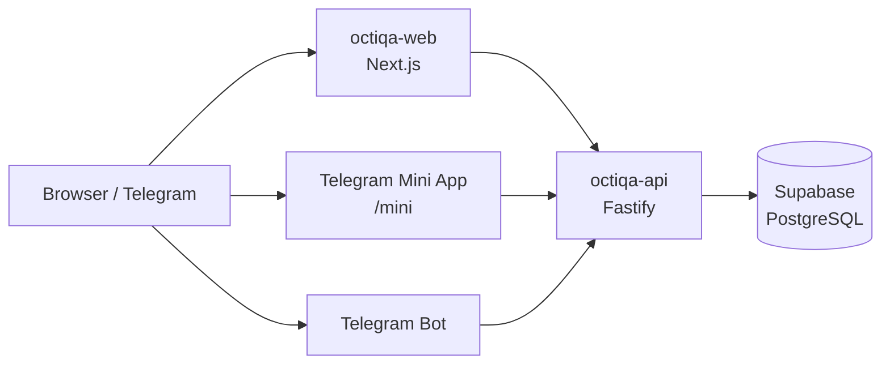

# Octiqa — карта системы

> **Octiqa** — платформа, которая помогает исполнителю управлять занятостью и связывает его с клиентом. Клиент находит специалиста через профиль, видит календарь занятости и связывается напрямую.

## Заметки

- **[[CURRENT|📍 Как работает сейчас]]** — **источник истины** по текущей логике. Начинай отсюда.
- [[entities|🧩 Сущности]] — Account / Provider / TelegramAccount / Subscription и связи между ними
- [[complexity-analysis|🔍 Анализ сложности]] — где трение + что уже сделано
- [[future-features|🔮 Будущие функции]] — ЭЦП-верификация через eGov и другие планы
- [[flow-specialist|🧑‍🍳 Сценарий специалиста (snapshot 2026-05-11)]] — *исходный дизайн, до рефакторингов*
- [[flow-client|🙋 Сценарий клиента (snapshot 2026-05-11)]] — *исходный дизайн, до рефакторингов*

## Архитектура одним взглядом

## Куда смотреть в коде

| Что | Где |
| --- | --- |
| Публичная страница профиля | `apps/web/src/app/p/[slug]/` |
| Поиск / landing | `apps/web/src/app/{page,search,for-specialists,for-clients}.tsx` |
| Регистрация / логин | `apps/web/src/app/{signup,login,forgot-password}/page.tsx` |
| Onboarding (5 шагов) | `apps/web/src/app/dashboard/onboarding/` |
| Web dashboard | `apps/web/src/app/dashboard/` |
| Telegram Mini App | `apps/web/src/app/mini/` |
| API auth | `apps/api/src/auth/` |
| API providers | `apps/api/src/providers/` |
| API calendar | `apps/api/src/calendar/` |
| API telegram bot + mini-auth | `apps/api/src/telegram/` |
| API subscription / payments | `apps/api/src/subscription/` |
| API analytics | `apps/api/src/analytics/` |
| Миграции БД | `supabase/migrations/` |
| Wire-типы (SSOT) | `packages/types/src/domain.ts` |

## Контекст

- **Stack**: pnpm workspaces; Fastify v5 (API) + Next.js 15 (Web) + Supabase Postgres
- **Deploy**: Render (Docker, multi-stage), Web и API раздельно
- **Reference base**: Казахстан (ISO 3166-2:KZ) — 20 регионов, ~55 городов
- **Подписка**: на аккаунт (одна подписка покрывает все Provider'ы аккаунта). Trial 30 дней, цена 9900 KZT/мес
