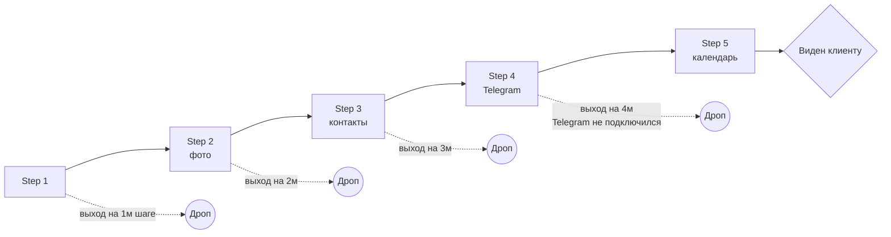

> **Статус реализации (2026-05-11):** идеи 2, 4, 5, 6 + foundation идеи 1 — реализованы. См. секцию **«Что уже сделано»** в конце.

# 🔍 Анализ сложности

> Объективный взгляд на путь специалиста. Цель — найти точки трения и предложить упрощения. Не критика ради критики, а карта того, что **реально мешает первому профилю**.

## TL;DR

Сейчас специалист, чтобы получить рабочий профиль, должен:

1. Зарегистрироваться (`/signup`)
2. Пройти **5 экранов** onboarding'а
3. На шаге 4 — **отдельно** установить Telegram-бот и кликнуть deep-link
4. Опционально — заполнить календарь
5. Понять, что есть **три параллельных UI** (web dashboard, mini app, бот) и научиться выбирать
6. Подождать, пока подписка trial не закончится, чтобы узнать о плате
7. Если у него больше одного направления (например, и тамада, и DJ) — открыть для себя multi-profile

**Вывод**: путь перегружен. У типичного специалиста за плечами TikTok/Instagram-профиль и расчёт «настроил за 5 минут — пошёл работать». Сейчас «5 минут» = только signup. Остальное может занять 30+ минут.

## Точки трения по шагам

### 🚧 Трение 1. Двойная точка входа

```mermaid
flowchart LR
    U([Специалист]) --> A[Регистрация на сайте]
    U --> B[/start в боте]
    A -.->|нет связи без шага 4| B
```

- Web и Telegram-бот — независимые миры. На сайте создаётся Account, в боте — ничего, пока не отсканировал deep-link на шаге 4.
- Если специалист «начал с бота» (что естественно для Telegram-native пользователя), его встречает [[entities|MiniGuestGate]] — гостевой режим, но без полноценных возможностей. Гость **должен** уйти на сайт, чтобы сделать setup.

**Что не так**: «нативный» путь (бот) бессилен без «не нативного» (сайт). Это инверсия ожиданий.

### 🚧 Трение 2. Onboarding «всё или ничего»

Сейчас 5 шагов, profile становится `visible` только после **завершения всех** (или явного skip каждого). На любом промежуточном шаге специалист уже залогинен, но клиент его не видит.



**Метрика-индикатор** (если у нас есть): доля Account'ов с `provider_onboarding.status != 'completed'`. Подозрение: значительная.

### 🚧 Трение 3. Telegram-привязка — отдельный осознанный шаг

На Step 4 специалист видит кнопку «Открыть Telegram». Внутри головы: «зачем мне это, я хочу профиль на сайте». В реальности — без линка бот не шлёт уведомления, Mini App не работает.

**Корневая причина**: Telegram-интеграция позиционируется как «one of many integrations», хотя на деле она центральная для продукта (бот + mini app = главное место работы).

### 🚧 Трение 4. Три UI с пересекающейся функциональностью

| Функция | Web dashboard | Mini App | Бот |
| --- | :---: | :---: | :---: |
| Редактирование профиля | ✅ | ✅ | ❌ |
| Управление календарём | ✅ | ✅ | ✅ (quick booking) |
| Аналитика | ✅ | ✅ | ❌ |
| Подписка / оплата | ✅ | ✅ | ❌ |
| Команда (помощники) | ❌ | ✅ | ❌ |
| Передача профиля | ❌ | ✅ | ❌ |
| Уведомления | ❌ | ❌ | ✅ |

Специалист каждый раз думает: «где это сделать?». Часть фич есть только в Mini App, часть только в боте. Web dashboard — оставшийся «общий знаменатель» по основным фичам, но не имеет команды и transfers.

**Артефакт истории**: web dashboard был первым (Tasks 13–18), Mini App пришёл позже (Tasks 25–29) и принёс power-фичи. Web никогда не догнал.

### 🚧 Трение 5. Подписка-«сюрприз»

- Trial автоматический, 30 дней.
- В UI почти нет постоянного напоминания «вы на trial, осталось N дней».
- В день N+1 после окончания trial → профиль исчезает из поиска. Специалист не понимает, почему «вчера было видно, сегодня нет».
- Оплата → инвойс Kaspi → веб-страница оплаты → возврат. Многошагово.

### 🚧 Трение 6. Multi-profile — концептуально тяжело

- 95% специалистов имеют **один** профиль.
- 5% — больше (мультидисциплинарные: тамада + DJ).
- При этом структура данных (Account → many Provider) и UI (переключатель в топбаре, экран «Profiles») проектируются под second case.
- Для одного профиля видеть кнопку «Switch profile» избыточно и сбивает.

### 🚧 Трение 7. Power-фичи в «Settings» Mini App

В `MiniMoreScreen` → «Настройки» **в одном экране**:
- Аккаунт + ФИО
- Публичная страница (showOwnerName, showRelatedProfiles)
- Telegram primary
- Архив профиля
- Передача профиля (`pending` request)
- **Hard-delete профиля** с подтверждением ввода названия
- Поддержка
- Logout

Эта простыня — экран `SettingsTool` 305 строк после декомпозиции. Для типичного специалиста 80% этих кнопок не нужно никогда. Но они все на виду, и среди них — кнопка удаления, и кнопка transfer (которая ломает текущий setup, если случайно нажать).

### 🚧 Трение 8. Клиентский путь не цикличен

После того как клиент связался по WhatsApp, **возврат на платформу нулевой**. Нет отзывов, нет «оставить контакт обратно», нет повторного бронирования через профиль. Octiqa = одноразовый touchpoint.

## Что я бы переделал

> Это **идеи для будущей переделки**, не действия сейчас. Применять по обсуждению.

### 💡 1. Telegram-first onboarding

**Сейчас**: сайт → signup → onboarding → Telegram linking (4-й шаг).
**Альтернатива**: бот → `/start` → диалог в боте + Mini App создаёт Account автоматически по `telegram_user_id`. Сайт нужен только для публичной страницы профиля.

- Account создаётся при первом `/start` или открытии Mini App (`telegram_user_id` → unique key).
- Phone и password — опциональны (нужны только если специалист хочет логиниться с веба).
- Onboarding в Mini App, не на вебе.

**Эффект**: «1 шаг» вместо «4-х». Telegram-native сценарий первичный.

### 💡 2. Progressive publish: «опубликовать профиль с минимумом»

**Сейчас**: 5 шагов до публикации.
**Альтернатива**: достаточно **3 поля** (имя + категория + город) → профиль `visible`. Дальше — улучшения по желанию.

- Фото — опционально (используется автоградиент `nameToGradient`, уже есть).
- Контакты — добавляются позже через «Дополнить профиль» баннер.
- Календарь — необязателен, пустой ≡ «свободен по умолчанию».

**Эффект**: первый «успех» (видимая страница) — через 30 секунд после старта.

### 💡 3. Один UI, не три

**Сейчас**: web dashboard + Mini App + бот.
**Альтернатива**:
- **Mini App** — единственный интерфейс управления (профиль, календарь, аналитика, подписка).
- **Бот** — только уведомления и quick-booking.
- **Web** — только публичная страница `/p/<slug>` + landing.

Web dashboard сворачивается в read-only «зеркало» Mini App или удаляется.

**Эффект**: одна модель «где что делать». Команда разработки фокусируется на одной поверхности.

### 💡 4. Подписка как заметная часть UI

- Постоянный счётчик «Trial: 23 дн» в топбаре Mini App.
- За 7 дней до конца — push в Telegram бот.
- Кнопка «Оплатить» на каждом «settings»-подобном экране, не только в Subscription.
- Опция «Auto-renew» (через сохранённый Kaspi-токен, если технически возможно).

### 💡 5. Multi-profile спрятать

- По умолчанию: один профиль, никаких переключателей.
- «Добавить ещё профиль» — кнопка в Settings → Advanced. Только тогда появляется UI переключения.

### 💡 6. Settings → разбить на «обычное» и «advanced»

**Обычное** (всегда видно): аккаунт, ФИО, публичная страница (toggles), Telegram primary.
**Advanced** (за кликом): архив, передача, hard-delete, помощники.

«Опасные» действия — за двойным экраном с предупреждением.

### 💡 7. Возвратный цикл для клиента

- После клика на контакт-кнопку — мягкое предложение «Сохранить контакт в Telegram» (создание чата с ботом).
- Бот через 30 дней спросит: «Вы работали с N? Как прошло?» — без отзывов на платформе, но как лояльность-механика.
- Это **долгий** заход, но даёт повторные касания.

## Что **точно правильно** в текущей системе

Для баланса — не всё перегружено:

- ✅ **Public profile `/p/<slug>`** — лаконичен, не требует регистрации клиента, SEO-friendly.
- ✅ **Account-level subscription** — правильное решение архитектурно (не путаница «подписка на профиль»).
- ✅ **Wire-типы в `@octiqa/types`** — недавняя унификация, чисто.
- ✅ **Mini App декомпозиция** (после Task 27) — структура `screens/`, `hooks/`, `overlays/` правильная.
- ✅ **`useVisibleViewport`** — после рефакторинга в этой сессии — централизованный хук для keyboard handling.
- ✅ **`normalizeLinkUrl`** — защита от мусорных URL (label-префиксы, относительные пути) — на API и Web синхронно.
- ✅ **Кеш-стратегия Mini App** — localStorage + фоновый prefetch (Tasks `2187af0`, `b6fd10d`) — UX отзывчивый.
- ✅ **Audit log + transfer accept-flow** — серьёзный B2B-grade.

## Метрики, которые стоит начать собирать

Если ещё нет — для подтверждения гипотез выше:

| Метрика | Где смотреть | Что подтверждает |
| --- | --- | --- |
| Drop-off по шагам onboarding | `provider_onboarding.status` + `current_step` | Трение 2 |
| Доля Account без `telegram_accounts` после signup | `accounts` LEFT JOIN | Трение 1, 3 |
| Доля Account с >1 Provider | `provider_accounts` GROUP BY account_id | Трение 6 |
| Среднее время от signup до первого `publication_status='visible'` | timestamps | Трение 2 |
| Конверсия `profile_views` → `contact_reveals` | `provider_analytics_events` | Качество публичной страницы |
| % сессий, где специалист открывает и web, и mini app | анонимный fingerprint | Трение 4 |

## Резюме

Сложность **есть**. Она исторически накопленная (web dashboard → mini app пришёл вторым → бот пришёл третьим). Каждая фича по отдельности оправдана, в сумме создают перегруз для нового пользователя.

**Главные кандидаты на упрощение** (в порядке ROI):
1. Telegram-first onboarding (идея 1).
2. Progressive publish (идея 2).
3. Один UI вместо трёх (идея 3).

Остальное — улучшения второго порядка.

## Что уже сделано

> Прогресс реализации идей из этого документа. Обновлять при каждом этапе.

### ✅ Идея 2 — Progressive publish
- **Коммиты:** `6b97812`, `8052b77`
- После Step1Basics онбординга профиль сразу переходит в `publication_status='visible'` (если был `draft`)
- Категория стала обязательной в Step1 — без неё профиль не виден в category-фильтре поиска
- Onboarding nav-кнопка «Пропустить» → «Закрыть» когда provider уже создан
- Dashboard banner: «Профиль опубликован — дополните» + кнопка «Дополнить →» (раньше «Завершите настройку профиля» + «Продолжить»)
- Steps 2–5 (фото/контакты/Telegram/календарь) теперь опциональные enhancements

### ✅ Идея 4 — Подписка как заметная часть UI
- **Коммиты:** `9ebe4ca`, `3c50edc`
- Badge в `MiniTopBar`: «Trial: N дн» / «Истекает: N дн» / «Подписка истекла» (оранжевый при ≤7 дн)
- Динамический подзаголовок в `MoreScreen` → row «Подписка»: «Пробный период · 23 дн осталось» и т.д.
- Префетч `/account/subscription` в `useMiniApp` параллельно с `/auth/me`

### ✅ Идея 5 — Multi-profile скрыт при одном профиле
- Уже было в коде на момент анализа (`MiniTopBar.tsx:114` chevron + `MiniShell.tsx:263` MiniSwitchSheet — оба скрыты при `activeProviders.length <= 1`)

### ✅ Идея 6 — Settings split на normal / advanced
- **Коммит:** `3a2f80b`
- В `SettingsTool`: Архив профиля, Передача профиля, Опасная зона (hard-delete) скрыты за toggle «Показать продвинутые настройки»
- Снаружи остаются: Аккаунт + ФИО, Публичная страница, Telegram primary, Поддержка, Logout

### 🟡 Идея 1 — Telegram-first onboarding (foundation готов, UX частично)
- **Foundation:** коммиты `9c76142`, `8977a76`
  - Создан `apps/web/src/lib/auth.ts` — полный SSOT для обоих токенов (`session_token` + `mini_auth_token`)
  - Помощники: `getSessionToken`/`setSessionToken`/`clearSessionToken`/`authHeaders` + `getMiniAuthToken`/`setMiniAuthToken`/`clearMiniAuthToken`/`isMiniAuthTokenValid`/`miniAuthHeaders`/`combinedAuthHeaders`
  - В коде больше нет ни одного inline `localStorage.getItem('session_token')` или `localStorage.*Item('mini_auth_*')` — будущая замена auth-механизма требует правок только в `@/lib/auth.ts`
- **UX:** коммит `0493a30`
  - `MiniGuestGate` рефакторинг: 2 шага → 1 экран, форма открыта сразу с предзаполненным именем из `tgUser`
  - Тексты: «Добро пожаловать, Имя!» вместо «Octiqa для специалистов»; 3 Benefit-карточки (📅/🌐/🔔) вместо технических InfoRow (аккаунт/профиль/сайт)
  - CTA «Начать в Octiqa» вместо «Создать аккаунт»
- **Уже Telegram-first до этой сессии:** `/page.tsx` (главная), `/for-specialists/page.tsx` — все CTA через `TELEGRAM_DASHBOARD_LINK` / `TELEGRAM_ONBOARDING_LINK`, ссылок на `/signup` нет
- **Осталось:** перенос фактического onboarding-flow в Mini App (сейчас он на web `/dashboard/onboarding`). Это большой проект — заранее не начат.

### 🟡 Идея 3 — Один UI вместо трёх (Phase 1 done)
- **Phase 1 done (2026-05-12):** `MoveToMiniBanner` на всех dashboard-страницах (кроме onboarding) — мягко нудж'ит «Управление в Telegram Mini App», CTA «Открыть →» через `TELEGRAM_DASHBOARD_LINK`. Закрыт последний content-gap: `NotificationsTool` (лог Telegram-уведомлений) добавлен в Mini App More. Теперь функционал web dashboard и Mini App совпадает 1:1.
- **Phase 2 (следующее):** наблюдать долю сессий Mini App vs web. Если Mini App доминирует — Phase 3.
- **Phase 3 (отложено):** web dashboard → read-only или удалить. Останется только публичная `/p/<slug>` + landing.

### ⏳ Идея 7 — Возвратный цикл для клиента
- Не начато. Требует новых endpoints + интеграции с Telegram-ботом (30-дневный ping). Trust-механика — отдельная инициатива.
