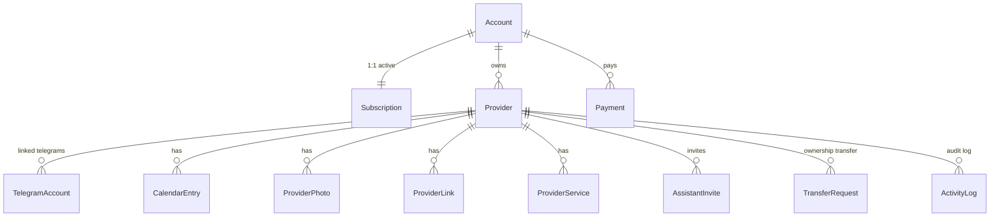

# 🧩 Сущности и связи

> Кто на ком держится. SSOT для wire-типов: `packages/types/src/domain.ts`. SSOT для DB-типов: `apps/api/src/*/repositories.ts` (с `Date` и внутренними полями).

## Главная схема

## Сущности

### Account
> «Учётная запись» — то, чем логинятся. Один человек = один Account.

- `id` — uuid
- `username` — уникальный логин
- `phone` — единственный обязательный контакт
- `password_hash`
- `full_name` — ФИО (опционально, для топбара и публичного профиля)
- `status` — `pending_verification` / `active` / `blocked`
- `show_related_profiles` — показывать ли блок «другие профили этого человека» на публичной странице

**Файлы**: `apps/api/src/auth/repositories.ts`, миграции `001`, `025_account_full_name`.

### Provider
> «Профиль специалиста». Один Account может владеть несколькими (multi-profile с Task 32).

- `id` — uuid
- `display_name`, `slug` (`/p/<slug>`)
- `bio`, `country_code`, `region`, `city`, `district`, `address_text`, `timezone`
- `primary_category`, `primary_subcategory`
- `provider_status` — `active` / `inactive` / `sick` / `vacation` / `blocked`
- `publication_status` — `draft` / `visible` / `hidden` / `suspended`
- `is_featured`, `is_verified`
- `archived_at`, `pending_delete_at` — для архива и hard-delete
- `show_owner_name` — показывать ли ФИО владельца на публичном профиле

**Подресурсы**: `provider_photos`, `provider_links`, `provider_services`.

**Файлы**: `apps/api/src/providers/`, миграции `004`, `016_multi_profile_foundation`, `024_provider_owner_name`.

### TelegramAccount
> Привязка Telegram-пользователя к Provider'у. Используется ботом и Mini App.

- `id`, `provider_id`, `account_id`
- `telegram_user_id`, `telegram_username`, `telegram_first_name/last_name`
- `telegram_role` — `owner` / `assistant` / `manager` / `spouse` / `child` / `partner` / `other`
- `is_primary` — главный Telegram для этого Provider'а (используется для notifications)
- `status` — `pending` / `linked` / `unlinked` / `blocked`
- `linked_at`, `unlinked_at`

**Файлы**: `apps/api/src/telegram/repositories.ts`, миграции `008_telegram_accounts`, `017_assistant_invites`.

### Subscription
> Подписка на **аккаунт**, не на профиль. Одна подписка покрывает все Provider'ы аккаунта (Task `61e1ac4` `011_account_subscription`).

- `id`, `account_id`, `plan_code`
- `status` — `trial` / `active` / `expiring` / `expired` / `blocked` / `cancelled`
- `starts_at`, `expires_at`, `trial_ends_at`, `grace_until`
- `included_profile_count`, `extra_profile_slots`, `max_active_profiles`

Дефолты: trial 30 дней, цена 9900 KZT/мес, базовая поставка = 1 профиль, продуктовый лимит = 3 профиля.

**Файлы**: `apps/api/src/subscription/`, миграции `006_subscriptions`, `011_account_subscription`, `019_account_subscription_related_profiles`.

### Payment
> Транзакция оплаты подписки. Сейчас единственный провайдер — Kaspi.

- `id`, `account_id`, `subscription_id`
- `payment_provider` — `kaspi` / `other`
- `amount`, `currency`, `status` — `pending` / `paid` / `failed` / `expired` / `cancelled`
- `phone` (telephone, на который выставлен invoice)

### CalendarEntry
> Запись о занятости. Видна публично на профиле.

- `id`, `provider_id`
- `starts_at`, `ends_at`, `status` — `busy` / `free` / `tentative` / `blocked` / `vacation`
- `title`, `notes` (внутренние, не показываются клиенту)
- Связанный `calendar_entry_client` (опционально, для booking-логики у специалиста)

**Файлы**: `apps/api/src/calendar/`, миграции `005`, `023_calendar_vacation_status`.

### AssistantInvite (через `telegram_link_tokens`)
> Owner создаёт invite-токен → выдаёт deep-link → помощник кликает → линкуется с ролью `assistant`.

### TransferRequest
> Передача владения Provider'ом другому Account'у. Двухсторонний accept-flow.

- Owner → создаёт `pending` request с `expires_at +24h` и `to_phone` (телефон нового владельца).
- Новый owner → видит в Mini App → принимает/отклоняет.
- При accept: `provider_accounts.account_id` обновляется атомарно.

**Файлы**: `apps/api/src/telegram/repositories.ts`, миграция `020_transfer_accept_flow`.

### ActivityLog
> Аудит-лог действий по профилю. Видно в Mini App → More → История действий.

`action_type`: `calendar_created`, `calendar_updated`, `calendar_deleted`, `assistant_invited`, `assistant_revoked`, `telegram_linked`, `telegram_unlinked`, `profile_archived`, `profile_unarchived`, `profile_pending_delete`, `ownership_transfer_created/accepted/rejected`, `primary_telegram_changed`.

## Reference-таблицы (справочники)

| Таблица | Что хранит | Пример |
| --- | --- | --- |
| `ref_countries` | Страны | `KZ` |
| `ref_regions` | Регионы | Алматинская область |
| `ref_cities` | Города | Алматы |
| `ref_categories` | Категории специалистов | Тамада, Фотограф, DJ |
| `ref_subcategories` | Подкатегории | «Свадебный фотограф», «Корпоративный ведущий» |
| `ref_currencies` | Валюты | KZT |
| `ref_link_types` | Типы ссылок | whatsapp, telegram, instagram, phone, website |

Все справочники публичные (`/reference/*`), кешируются CDN.

## Ключевые view'ы и индексы

- `public_providers_search` — только `publication_status='visible'` + активная подписка. То, что видит клиент в поиске.
- Уникальный `provider_links(provider_id, link_type)` — один тип ссылки на профиль.
- Партиальный уникальный индекс на `notification_jobs` для дедупа.

## Где «истина» для каждого поля

| Поле | API repository (`Date`, полное) | Wire (`@octiqa/types`, для UI) |
| --- | --- | --- |
| Account | `apps/api/src/auth/repositories.ts` | `Account` |
| Subscription, Payment, PlanLimits | `apps/api/src/subscription/repositories.ts` | соответствующие типы |
| TelegramAccount | `apps/api/src/telegram/repositories.ts` | `TelegramAccount` |
| Provider, CalendarEntry, Photos, Links, Services | inline в API + miграции | `Provider`, `CalendarEntry`, `ProviderPhoto`, `ProviderLink`, `ProviderService` |
| TransferRequest, ActivityLog | inline в `telegram/` | `TransferRequest`, `ActivityLog` |
