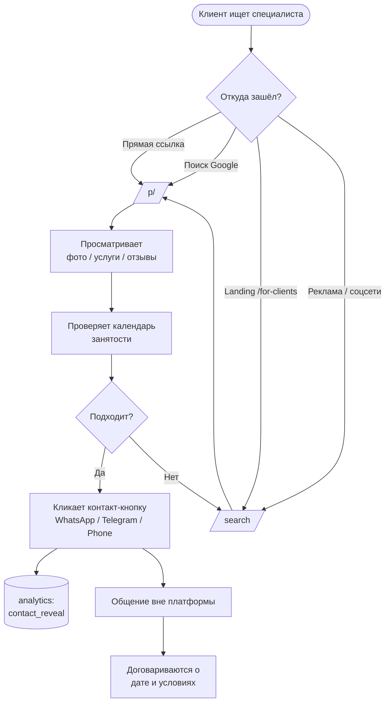

# 🙋 Сценарий клиента

> Клиент — это человек, который ищет специалиста (тамаду, фотографа, DJ и т.д.) для своего события. Регистрация на платформе **не требуется**.

## Карта сценария

## 1. Точки входа

| Откуда | Куда попадает | Кто привёл |
| --- | --- | --- |
| **Прямая ссылка** на профиль | `/p/<slug>` | Сам специалист (визитка, соцсети, Telegram) |
| **Поиск Google / Yandex** | `/p/<slug>` (благодаря SEO) | SEO-метаданные, sitemap.xml |
| **Главная Octiqa** | `/` или `/for-clients` | Brand reach |
| **Поиск по сайту** | `/search` → `/p/<slug>` | Self-discovery |

Регистрация клиента **не нужна**. Anonymous browsing.

## 2. Просмотр профиля `/p/<slug>`

Серверный компонент с `generateMetadata` (SEO) + ISR `revalidate: 60s`. Файл: `apps/web/src/app/p/[slug]/`.

### Что видит клиент

1. **Hero**: имя, аватар/градиент по имени, категория, подкатегория, город.
2. **Фото-галерея**: cover + дополнительные фото.
3. **Bio**: описание специалиста.
4. **Услуги и цены** (если заполнены — `provider_services`).
5. **Календарь занятости** (`PublicCalendarEntry`):
   - **Свободно** (зелёный) — без записи
   - **Занято** (красный) — `busy`
   - **Под вопросом** (жёлтый) — `tentative`
   - **Отпуск** (другой оттенок) — `vacation`
   - **Прошедшие дни** — пастельные
   
   Календарь — пассивный: клиент **не бронирует** через него, только видит занятость.
6. **Контакты** — кнопки: WhatsApp, Telegram, Instagram, Phone, Website.
7. **Связанные профили** — если у Account несколько Provider'ов и `show_related_profiles=true`, показывается блок (миграция `019`).
8. **Имя владельца** (опционально, `show_owner_name=true`) — если специалист хочет показать ФИО, кроме брендового имени.

## 3. Контакт

1. Клиент кликает кнопку **«WhatsApp»** (или другую).
2. Frontend дёргает API `POST /providers/<id>/track-contact` → запись в `provider_analytics_events` (миграция `013_analytics`).
3. Открывается deep-link: `https://wa.me/<phone>` / `tg://resolve?domain=<username>` / `tel:<phone>` / ссылка на сайт.
4. Дальнейшее общение — **вне платформы**.

## 4. Что отслеживается

Аналитика для специалиста (видна в `/dashboard/analytics`):

| Метрика | Когда инкрементится |
| --- | --- |
| `profile_views` | Загрузка страницы `/p/<slug>` (с дедупом по session_id) |
| `contact_reveals` | Клик на контакт-кнопку |
| `calendar_views` | Открытие/листание календаря |

`session_id` — anonymous, генерируется в `sessionStorage` (см. `profileHelpers.ts:getSessionId`).

## 5. Что клиент **не делает**

- **Не регистрируется** на платформе.
- **Не пишет отзывы** (отзывов в системе сейчас нет).
- **Не оплачивает услуги специалиста через Octiqa.** Все деньги ходят напрямую между клиентом и специалистом.
- **Не бронирует слот** через сайт. Календарь — это витрина занятости, не booking-инструмент.
- **Не видит цены, если специалист их не указал.** Услуги опциональны.

## 6. Конверсия и SEO

- **Sitemap**: `/sitemap.xml` (revalidates hourly) — все `publication_status=visible` профили.
- **Robots**: `/robots.txt`.
- **Per-profile metadata**: `generateMetadata` в `/p/[slug]/page.tsx` — title, description, og-image (cover).
- **ISR revalidation**: 60 секунд для актуальности.
- **Поиск Google**: должен видеть профили активных специалистов, у которых подписка не expired.

## Известные точки трения

См. отдельный файл: [[complexity-analysis]] — раздел про клиентский сценарий.
