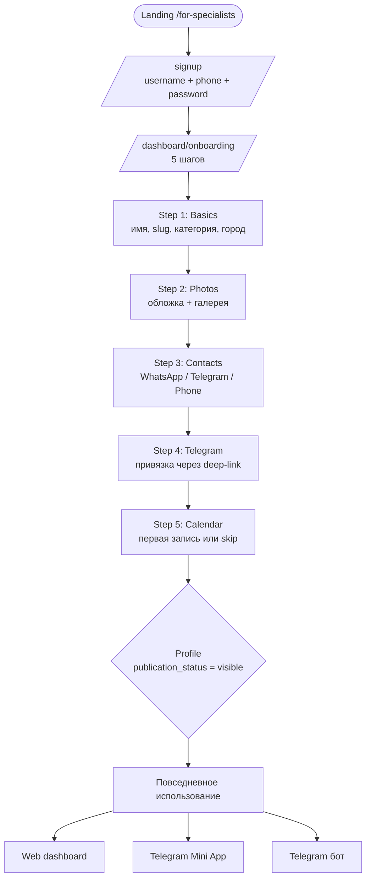

# 🧑‍🍳 Сценарий специалиста (исполнителя)

> Полный путь от первого касания до повседневного использования. Шаги в логическом порядке.

## Карта сценария

## 1. Знакомство и регистрация

1. Специалист попадает на **landing** — либо `/` (главная), либо `/for-specialists` (отдельная посадочная под исполнителей, [[#^audience-split|Task 21]]).
2. Кликает **«Зарегистрироваться»** → переходит на `/signup`.
3. Вводит: **username** (уникальный, ≥3 симв), **phone** (KZ), **password**. Phone валидируется на формат.
4. API создаёт запись в таблице `accounts` со статусом `active` (`apps/api/src/auth/repositories.ts` → `createAccount`). Phone сразу `phone_verified_at = NOW()` — без SMS-подтверждения.
5. Сразу выдаётся **session token** (Bearer) → сохраняется в `localStorage` как `session_token`.
6. Авторедирект: **`/dashboard/onboarding`**.

## 2. Onboarding (5 шагов)

> Реализован в `apps/web/src/app/dashboard/onboarding/`, миграции `014_onboarding.sql`. Состояние сохраняется на сервере в таблице `provider_onboarding` — можно вернуться и продолжить.

### Step 1 — Basics

- **Display name** (видимое имя)
- **Slug** (URL — `/p/<slug>`) — автогенерируется транслитерацией кириллицы (см. [[entities|toSlug]])
- **Category** + **Subcategory** (из справочника `ref_categories` / `ref_subcategories`)
- **City** (из справочника `ref_cities`)
- **Bio** (опционально)

Создаётся запись в `providers`, привязывается к `accounts.id` через `provider_accounts`.

### Step 2 — Photos

- Загрузка cover (обложка) и доп. фото в Supabase Storage.
- Sort order настраивается.
- Можно пропустить — но без фото профиль уязвим (низкая конверсия в контакт).

### Step 3 — Contacts (Links)

- WhatsApp, Telegram, Instagram, Phone, Website — всё опционально.
- URL'ы проходят через `normalizeLinkUrl` (нормализация + защита от label-префикса).
- Минимум один контакт нужен, иначе клиенту некуда писать.

### Step 4 — Telegram link

- API генерирует **deep-link** через `/telegram/link-token` → `t.me/<bot>?start=<token>`.
- Специалист открывает ссылку → бот ловит `/start <token>` → API создаёт `telegram_accounts` запись `(provider_id, telegram_user_id, status=linked, telegram_role=owner, is_primary=true)`.
- Без этого шага: бот и Mini App не работают для этого специалиста. Только web-доступ.

### Step 5 — Calendar

- Опциональный первый календарь: пометить день как **busy** / **tentative** / **vacation**.
- Цель — сразу показать клиенту, что специалист «занят».

После завершения: `provider.publication_status = 'visible'` (если подписка активна). Профиль появляется в `public_providers_search`.

## 3. Подписка и trial

- При создании первого Provider'а: автоматически выдаётся **30-дневный trial** (миграция `015_backfill_trial_subscriptions.sql`).
- Подписка **на аккаунт** — одна на всех Provider'ов аккаунта (миграция `011_account_subscription.sql`).
- После trial: если не оплачено → `subscription.status = 'expired'` → провайдеры скрываются из публичного поиска.
- Оплата: ввод телефона Kaspi → API создаёт invoice (`/account/payments/create-invoice`) → клиент оплачивает через Kaspi → webhook отмечает payment `paid`.

## 4. Повседневное использование — 3 UI

### A. Web dashboard (`/dashboard`)

- `/dashboard` — главная (онбординг-статус, переходы)
- `/dashboard/provider` — список профилей аккаунта
- `/dashboard/provider/edit` — редактирование профиля
- `/dashboard/calendar` — управление календарём
- `/dashboard/analytics` — статистика (просмотры / контакты / топ дней)
- `/dashboard/integrations` — Telegram-привязки
- `/dashboard/subscription` — статус подписки и оплата
- `/dashboard/settings` — аккаунт, удаление, ФИО
- `/dashboard/notifications` — лог отправленных напоминаний

### B. Telegram Mini App (`/mini`)

> Открывается из бота через кнопку «Open App». Auth через Telegram `initData` (HMAC-проверка серверной стороны — Task 35, миграция `018_mini_app_auth`).

Экраны:
- **Profiles** — список + переключатель + редактирование
- **Calendar** — месячный вид, добавление записей
- **Analytics** — основные метрики
- **More** — настройки, подписка, команда, передачи, история действий

См. декомпозицию: `apps/web/src/app/mini/screens/more/*Tool.tsx`.

### C. Telegram бот (`apps/api/src/telegram/bot.ts`)

- Уведомления о напоминаниях (event_reminder, subscription_reminder, calendar_stale_reminder)
- Quick booking: текст или voice-message → STT → парсинг → создание calendar entry
- Команды: `/start`, `/help`, привязка профиля по deep-link

## 5. Power-фичи (продвинутый специалист)

### Multi-profile
- Один Account → много Provider'ов (миграция `016_multi_profile_foundation`).
- Лимиты подписки: `included_profile_count` + `extra_profile_slots`. Default base = 1.
- Переключатель `MiniSwitchSheet` в Mini App.

### Assistant invites (помощники)
- Owner → создаёт `/providers/:id/assistant-invite` → deep-link на бота.
- Помощник кликает → линкуется к Provider'у с `telegram_role = assistant`.
- Доступ к календарю, без права удаления (см. `apps/api/src/telegram/permissions.ts`).
- Миграция `017_assistant_invites`.

### Transfers (передача профиля)
- Owner → `/providers/:id/transfer-request` (telephone → new owner).
- Создаётся `transfer_request` со статусом `pending`, expires_at +24h.
- Новый owner должен **явно принять** в Mini App (Settings → Передачи).
- Миграции `020_transfer_accept_flow`.

### Archive / Hard-delete
- Archive: `provider.archived_at = NOW()` — скрыт от клиентов, обратимо.
- Hard-delete: `provider.pending_delete_at = NOW()` — помечен на удаление, фоновый job чистит.

## 6. Что специалист **не делает** напрямую

- **Не общается с клиентом внутри платформы.** Платформа = витрина + связь. Сам диалог идёт в WhatsApp/Telegram/звонке.
- **Не выставляет счета клиенту через платформу.** Оплата только за подписку Octiqa.
- **Не управляет SEO профиля.** Slug и метаданные генерируются автоматически.

## Известные точки трения

См. отдельный файл: [[complexity-analysis]].

^audience-split:
*Task 21 (`a33825f`) разбил landing по аудиториям: `/for-clients` и `/for-specialists`.*
