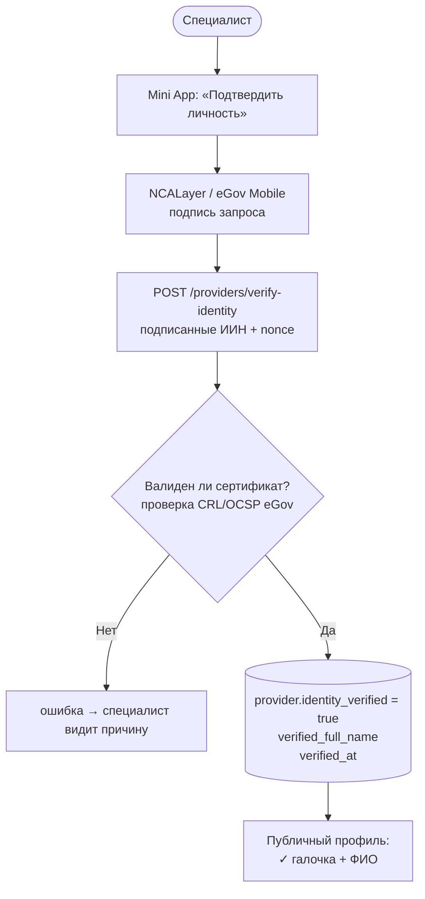

# 🔮 Будущие функции

> Заметки о фичах, которые планируем внедрить. Не для реализации сейчас — для контекста и проектирования.

## 🆔 ЭЦП-верификация личности специалиста (через eGov)

### Проблема

На платформе нет способа отличить «настоящего» специалиста от мошенника, который выдаёт себя за исполнителя (фейковый профиль, чужие фото). Клиент рискует деньгами и срывом события.

### Решение

Интеграция с **eGov (egov.kz)** через ЭЦП — Электронную цифровую подпись (NCALayer / NCANode). Специалист подписывает запрос на верификацию своим ИИН + ЭЦП-сертификатом → API получает подтверждение ФИО и факт владения сертификатом → отмечает Provider как `identity_verified`.

### Что меняется в UX

#### Для специалиста

1. В Mini App → Settings → новый раздел **«Подтверждение личности»**.
2. Кнопка **«Подтвердить через eGov»** → инструкция (требуется NCALayer установлен на устройстве или мобильное приложение eGov Mobile).
3. Подпись запроса (ИИН + nonce) через ЭЦП → отправка на API.
4. API верифицирует подпись (проверка сертификата по CRL/OCSP eGov) → если ОК, обновляет `provider.identity_verified = true`, сохраняет ФИО из сертификата в `provider.verified_full_name` и `verified_at`.
5. На публичном профиле появляется галочка ✓ **«Специалист подтвердил личность»**.

#### Для клиента

На странице `/p/<slug>`:

- Рядом с именем специалиста — **бейдж ✓ Verified** (зелёный, как у Telegram).
- Тултип / клик: «Личность подтверждена через eGov.kz, ФИО — *Иванов И.И.*» (показывать ФИО из сертификата, не displayName).
- В поиске `/search` — фильтр **«Только подтверждённые»**.
- Возможно: подтверждённые провайдеры приоритезируются в выдаче.



### Что меняется в данных

Новые поля в таблице `providers` (миграция, скажем, `028_identity_verification.sql`):

```sql
ALTER TABLE providers
  ADD COLUMN identity_verified boolean NOT NULL DEFAULT false,
  ADD COLUMN verified_full_name text,
  ADD COLUMN verified_iin_hash text,        -- хеш ИИН (не сам ИИН — PII)
  ADD COLUMN verified_at timestamptz,
  ADD COLUMN verified_certificate_serial text;

CREATE INDEX idx_providers_verified ON providers(identity_verified) WHERE identity_verified;
```

Wire-тип `Provider` в `@octiqa/types`: добавить опциональные поля `identity_verified?: boolean`, `verified_full_name?: string | null`, `verified_at?: string | null`.

### Технические нюансы

- **NCALayer** — десктопное приложение для работы с ЭЦП на ПК. Подпись делается на клиенте, на сервер уходит только signed blob.
- **eGov Mobile** — мобильное приложение, поддерживает QR-подпись (показываем QR в Mini App → пользователь сканирует и подписывает в eGov Mobile).
- **CMS / CAdES** — формат подписи. Сертификаты выдаются НУЦ РК.
- **Проверка сертификата**: онлайн (OCSP) или CRL. Удалённый CRL eGov надо периодически кешировать на API.
- **Privacy**: ИИН — PII. Храним только хеш + ФИО (которое уже на сертификате открыто). ИИН в логах — никогда.
- **Срок действия**: сертификат истекает. Раз в год проверять — если сертификат отозван или истёк, сбрасывать `identity_verified = false` (с уведомлением специалисту).

### Готовые библиотеки и интеграция

- На Web-стороне: **NCALayer WebSocket API** (`wss://127.0.0.1:13579/`). Готовые JS-обёртки есть как opensource.
- Серверная верификация подписи: **bouncycastle** (JVM) / **node-forge** (Node.js) — парсинг CMS, проверка цепочки сертификатов до Root CA НУЦ РК.
- Альтернатива (проще): **eGov Mobile API** (если откроют) — серверный flow, специалист подписывает в приложении.

### Этапы внедрения (черновик)

1. **MVP — самоотчёт**: специалист загружает скан удостоверения, ручная проверка модератором. Дёшево, медленно. Можно как промежуточный этап.
2. **NCALayer (desktop)**: рабочий flow для специалистов с компьютером. Покрывает 30–40% аудитории.
3. **eGov Mobile (QR-подпись)**: покрывает всех с Android/iOS. Главная цель.
4. **Автоматический ре-чек**: cron-job раз в месяц перечекивает действительность сертификатов.

### Что **не** делает эта фича

- Не подтверждает **квалификацию** специалиста (что он реально умеет петь / снимать). Только личность.
- Не блокирует неверифицированных — они продолжают работать, просто без галочки.
- Не отвечает за качество услуги — это уже территория отзывов (которой пока нет).

### Связь с другими планами

- Хорошо ложится на [[complexity-analysis|Telegram-first onboarding]]: подтверждение личности — следующий шаг после публикации профиля, не блокирует первое впечатление.
- Создаёт основу для **trust-фичи** в будущем (отзывы, рейтинг, диспуты).
