# 📋 Proposal: 1 специалист = 1 профиль (мульти-категория)

> **Статус:** на обсуждении. Не начата реализация. Окно открыто — пользователей пока нет.

## TL;DR

Большой архитектурный refactor. **Окно открыто — пользователей нет.**

1. **Multi-profile → single profile multi-category** — убираем 1 Account → много Providers, заменяем на 1:1 + массив категорий
2. **Помощники со scope** — помощник может быть привязан к подмножеству категорий (DJ-помощник vs Тамада-помощник)
3. **Дублирование уведомлений** — каждое действие помощника копией в Telegram owner'у
4. **Чистая отвязка** — revoke / leave удаляет данные `telegram_account` полностью (audit log остаётся анонимизированно)
5. **Помощник может уйти сам** — `POST /telegram/mini/assistant/leave`, тот же DELETE
6. **ФИО обязательно при регистрации** — `accounts.full_name NOT NULL`. После ЭЦП-верификации → immutable
7. **ЭЦП-верификация на Account, не на Provider** — подтверждается человек, не бренд
8. **Запись в БД только после явного «Сохранить»** — принцип фиксируется (уже работает)
9. **Авто-спячка через 90 дней неактивности** — профиль скрывается из поиска, owner активирует одним кликом

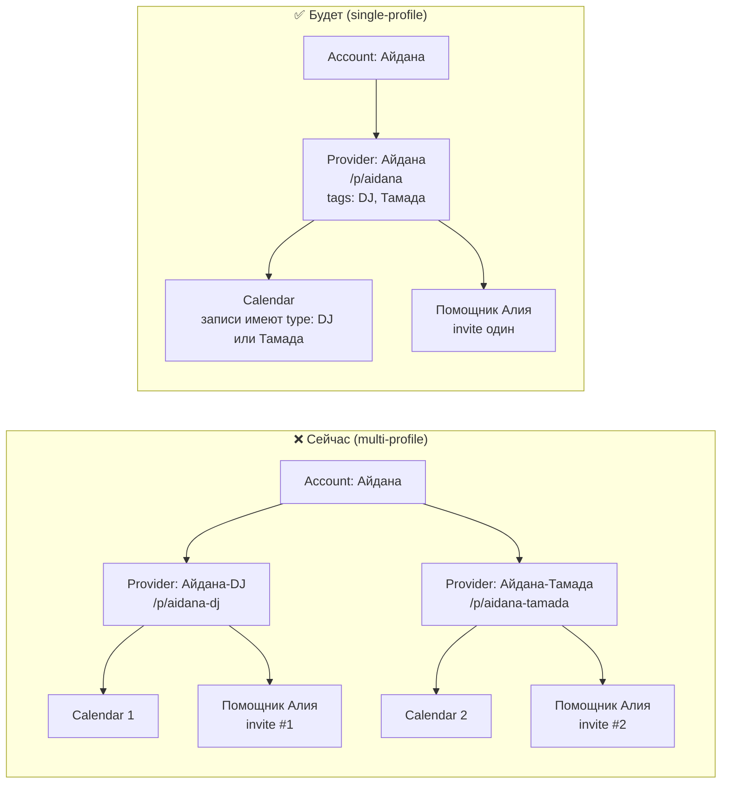

---

## 🎬 Конкретный сценарий: Айдана + помощница Алия

### Сейчас (4 шага со сложностями)

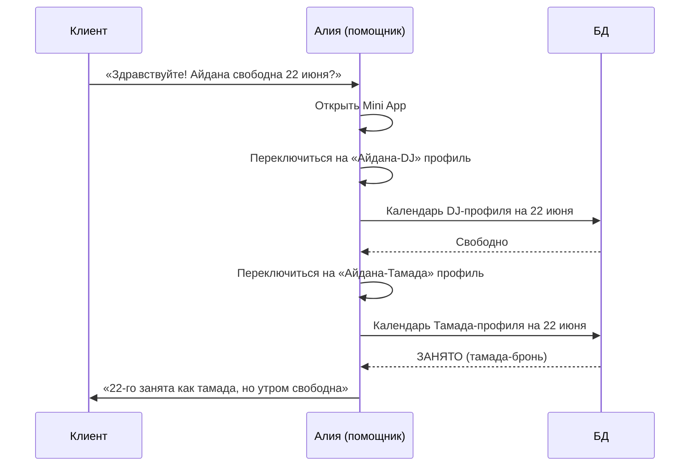

**Проблема:** Алия должна **дважды переключиться**, помнить о двух календарях, и физически Айдана **не может быть** одновременно DJ и тамадой — но в системе у неё 2 разных календаря.

### Будет (1 шаг)

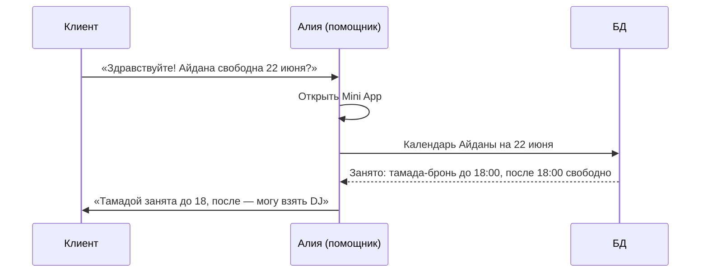

---

## 🧬 Модель данных: что меняется

### Сейчас

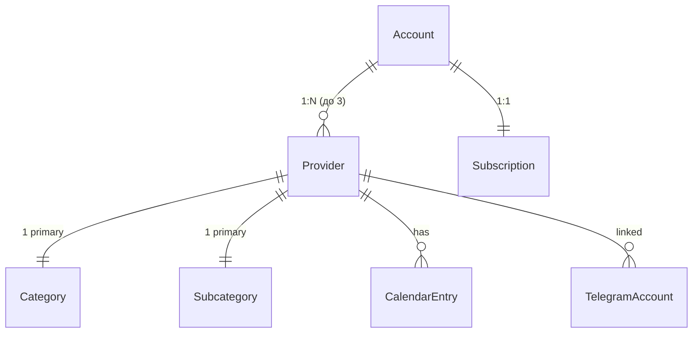

### Будет

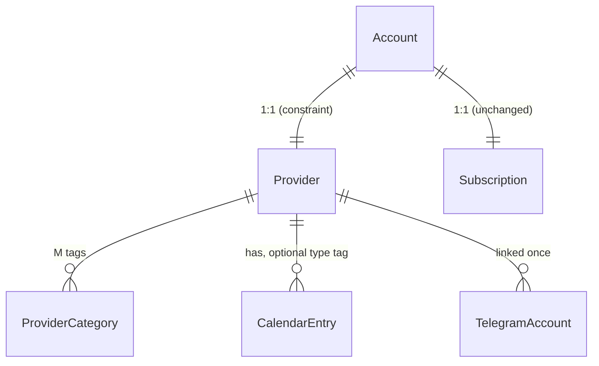

### Колонки/таблицы

| Что | Сейчас | Будет |
| --- | --- | --- |
| Связь Account ↔ Provider | `provider_accounts(account_id, provider_id)` — M:N | Колонка `providers.account_id` UNIQUE — 1:1 |
| Категория | `providers.primary_category` + `primary_subcategory` | Новая таблица `provider_categories(provider_id, category_code, subcategory_code, sort_order)` |
| Календарная запись | `calendar_entries(...)` | Та же + опц. колонка `category_tag` (для scope и аналитики) |
| **Scope помощника** | нет (помощник видит весь Provider) | Колонка `telegram_accounts.categories_scope text[]` (NULL = все категории, иначе массив `category_code`) |
| **ФИО (account.full_name)** | nullable | **NOT NULL** — обязательно на регистрации |
| **ЭЦП-верификация** | нет | На Account: `identity_verified_at`, `identity_locked_at`, `verified_iin_hash`, `verified_cert_serial` |
| **`provider.is_verified`** | колонка на провайдере | Удалена — источник истины `accounts.identity_verified_at` |
| **last_active_at** | нет | `accounts.last_active_at timestamptz` — обновляется на auth-pings |
| **publication_status** | `draft / visible / hidden / suspended` | + `'hibernated'` (для автоспячки) |
| Передача профиля | `transfer_requests` таблица + flow | **Удалена** |
| Архив профиля | работает | работает (без изменений) |
| Hard-delete профиля | работает | работает (без изменений) |
| Revoke помощника | `telegram_accounts.status = 'unlinked'` | **DELETE row** + анонимизация `actor_telegram_account_id → NULL` в `activity_log` |
| **Помощник сам уходит** | через owner revoke | Новый endpoint `POST /telegram/mini/assistant/leave` — то же поведение (DELETE + анонимизация), но инициатор помощник |

---

## 🧑‍🍳 Что видит специалист (Айдана)

### Onboarding (Step 1) — сейчас vs будет

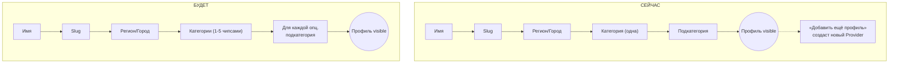

### Mini App для Айданы

**Сейчас:**
```
┌─────────────────────────────────┐
│  ⚫ Айдана-DJ (1/2) · виден  ⌄ │ ← переключатель!
├─────────────────────────────────┤
│  [Профили] [Кален.] [Анал.] ⋯  │
├─────────────────────────────────┤
│  Список профилей:               │
│   • Айдана-DJ        [править] │
│   • Айдана-Тамада    [править] │
│   • + Добавить (макс 3)         │
└─────────────────────────────────┘
```

**Будет:**
```
┌─────────────────────────────────┐
│  ⚫ Айдана · виден клиентам    │ ← без переключателя
├─────────────────────────────────┤
│  [Профиль] [Кален.] [Анал.] ⋯  │
├─────────────────────────────────┤
│  Айдана                         │
│  🎧 DJ · 🎤 Тамада              │ ← категории как чипсы
│  [Изменить категории]           │
│  [Фото] [Контакты] [Ссылка]    │
└─────────────────────────────────┘
```

### Создание записи в календаре

**Сейчас:**
1. Выбрать «какой профиль»
2. Указать «занято» 22 июня
3. (Календарь только этого профиля)

**Будет:**
1. Указать «занято» 22 июня
2. Опц. тег: «как DJ» / «как тамада» / без тега
3. (Календарь общий)

---

## 🙋 Что видит клиент

### Профиль `/p/aidana` (одна страница)

```
┌─────────────────────────────────────┐
│  ← Назад             ↗ Поделиться  │
├─────────────────────────────────────┤
│  [Фото-обложка]                     │
│                                     │
│  Айдана Нурланова  ✓ Верификация   │
│  📍 Алматы                          │
│  🎧 DJ  ·  🎤 Тамада                │ ← обе категории
│                                     │
│  [📲 Контакты]                      │
├─────────────────────────────────────┤
│  Услуги                             │
│  • DJ на свадьбу — от 100 000 ₸    │
│  • Тамада на свадьбу — от 80 000 ₸ │
├─────────────────────────────────────┤
│  📅 Календарь                       │
│   22 июня — занято · 🎤 тамада      │ ← опц. показывать чем именно
│   23 июня — свободно                │
└─────────────────────────────────────┘
```

### В поиске

- Клиент ищет `cat=DJ` → Айдана появляется
- Клиент ищет `cat=Тамада` → Айдана появляется
- Один URL `/p/aidana`, два разных trigger'а в поиске
- В сниппете: «🎧 DJ · 🎤 Тамада» — клиент видит, что специалист универсальный

---

## 🧑‍🤝‍🧑 Помощники — scoped доступ

> **Уточнение модели (по решению владельца, 2026-05-12).** Каждый помощник опционально привязан к подмножеству категорий. У Айданы может быть несколько помощников с разным scope. Owner всегда видит всё.

### Сценарий: Алия (DJ) + Бахыт (Тамада)

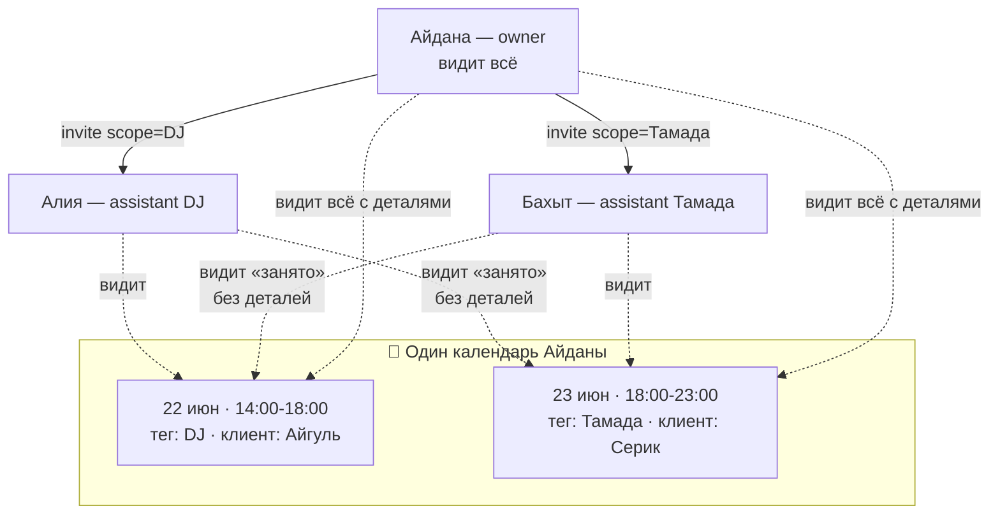

### Матрица прав

| Действие | Owner (Айдана) | Помощник в scope | Помощник вне scope |
| --- | --- | --- | --- |
| Видеть факт занятости (busy/free) | ✅ | ✅ | ✅ |
| Видеть детали записи (клиент, цена, заметки) | ✅ | ✅ (только своя категория) | ❌ (только «занято · не вашего направления») |
| Создать запись | ✅ (любая категория) | ✅ (только своя категория) | ❌ |
| Изменить запись | ✅ | ✅ (только в своей категории) | ❌ |
| Удалить запись | ✅ | ✅ (только в своей категории) | ❌ |
| Видеть аналитику профиля | ✅ (по всем категориям) | ✅ (только по своей) | — |
| Редактировать фото/контакты/категории профиля | ✅ | ❌ | ❌ |
| Управлять помощниками | ✅ | ❌ | ❌ |

### Что видит Алия (DJ-помощник) в календаре

```
┌─────────────────────────────────────┐
│  Календарь Айданы — DJ              │ ← в топбаре виден scope
├─────────────────────────────────────┤
│  22 июня                            │
│   14:00–18:00  Айгуль · 80 000 ₸    │ ← полные детали (DJ)
│   18:00–23:00  занято               │ ← без деталей (Тамада)
│                ↑ не вашего направления│
│  23 июня                            │
│   весь день    свободно             │
└─────────────────────────────────────┘
```

**Зачем видеть «занято» вне scope?** Чтобы Алия не приняла DJ-бронь на 22-е с 18:00, когда Айдана уже занята как тамада. Конфликт-преvention без раскрытия чужих данных.

### Помощник со scope = «все»

Если Айдана хочет одного универсального помощника (как раньше) — приглашает без scope, тот видит всё как сейчас.

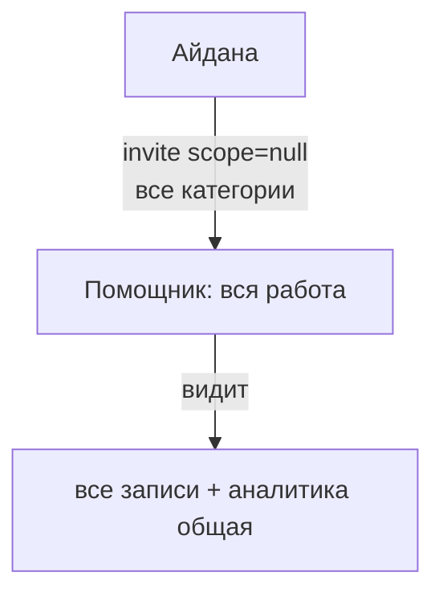

---

## 🔔 Дублирование уведомлений owner'у

Любое действие помощника → бот шлёт уведомление **owner'у** в Telegram:

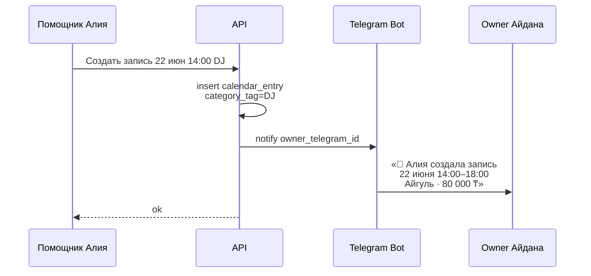

**Что доставляется owner'у:**
- Создание записи (с деталями)
- Изменение записи
- Удаление записи
- Принятие/отклонение брони (если есть booking flow)

Owner может в любой момент открыть Mini App и увидеть **полный лог действий помощников** в `ActivityTool` (уже есть в коде).

---

## ↩️ Отзыв полномочий и чистая отвязка

### Поток

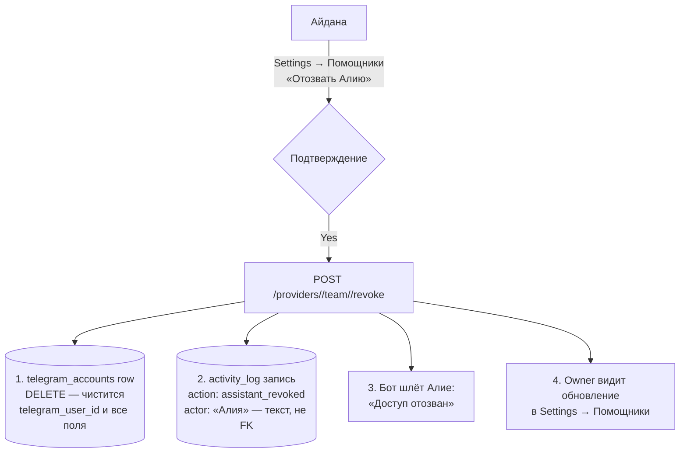

### Что именно удаляется

| Что | Поведение |
| --- | --- |
| `telegram_accounts` row | **DELETE** (полное удаление) |
| `telegram_user_id` Алии в БД | Больше не существует в связке с этим Provider |
| `activity_log` записи о действиях Алии | **Остаются** (для аудита), но `actor_telegram_account_id` = NULL, `actor_name` сохраняется как текст |
| Записи в календаре, созданные Алией | **Остаются** (они принадлежат Provider'у Айданы, не Алии) |
| Уведомления, которые Алия получала | Прекращаются (бот больше не шлёт ей в этот контекст) |

### Зачем такая чистка

**Сценарий:** Алия проработала помощником 3 месяца, потом ушла. Через год Алия решает зарегистрироваться как тамада сама.

- **Если данные остались:** при попытке `POST /telegram/mini/account` API увидит, что `telegram_user_id` Алии уже привязан к `telegram_accounts` (даже со статусом 'unlinked') и **может выдать ошибку** или повести себя странно.
- **Если данные удалены:** Алия регистрируется чисто, как новый пользователь. Никаких legacy-привязок.

Это правильный compromise между аудитом (история действий сохраняется в `activity_log`) и privacy/cleanness (личные данные удаляются полностью).

### Что owner может после revoke

- Пригласить другого помощника (новый invite-link)
- Изменить scope существующих помощников
- Продолжить вести сам (просто не приглашать никого)

---

## 🚪 Помощник уходит сам

Помощник может покинуть команду по собственному желанию (например, перестал работать с этим специалистом).

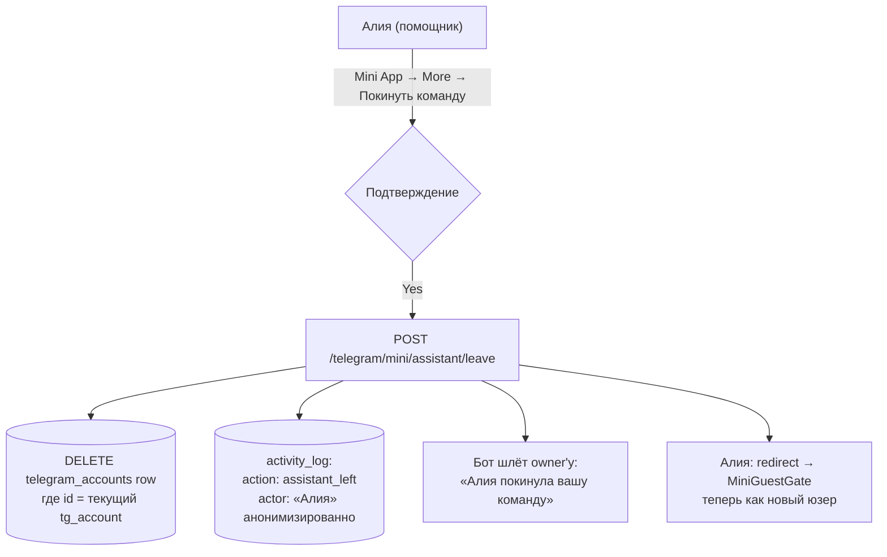

Поведение **идентичное** owner-revoke (DELETE row, анонимизация audit log) — отличается только инициатор и текст уведомления owner'у.

После этого Алия может сама зарегистрироваться как специалист — никаких legacy-привязок в БД.

---

## 🪪 ФИО, регистрация, верификация личности

> **Принцип:** Account — это **человек**. Provider — это **бренд/витрина**. Они независимы. Подтверждение личности (ЭЦП) — на Account.

### Поля Account

```sql
ALTER TABLE accounts
  ALTER COLUMN full_name SET NOT NULL,             -- было nullable, теперь обязательное
  ADD COLUMN identity_verified_at  timestamptz,   -- момент успешной верификации
  ADD COLUMN identity_locked_at    timestamptz,   -- момент блокировки full_name
  ADD COLUMN verified_iin_hash     text,           -- хеш ИИН (не сам ИИН — PII)
  ADD COLUMN verified_cert_serial  text;           -- серийный номер ЭЦП-сертификата
```

### ФИО vs display_name

| Поле | На чём | Что хранит | Пример |
| --- | --- | --- | --- |
| `accounts.full_name` | Человек | Реальное ФИО (для ЭЦП-matches) | «Айдана Нурланова» |
| `providers.display_name` | Бренд | Имя бренда / витрины | «Айдана DJ» или «DJ Spektr» |
| `accounts.show_owner_name` | Toggle | Показывать ли ФИО на публичном профиле | true / false |

### Регистрация (первая запись в БД)

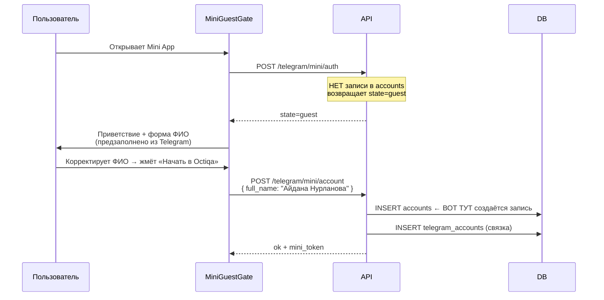

**Принцип:** запись в `accounts` создаётся **только после явного клика** «Сохранить» / «Начать в Octiqa». Никогда до. (Это уже работает в коде, фиксируем как инвариант.)

**Валидация на регистрации:**
- `full_name.length >= 2` — минимальная длина
- Label явно говорит «ФИО — используется для подтверждения личности»
- Helper text: «Можно изменить позже до подтверждения личности»
- Строгой проверки на «настоящее имя» НЕТ — это проверяется на этапе ЭЦП

### Жизненный цикл `full_name`

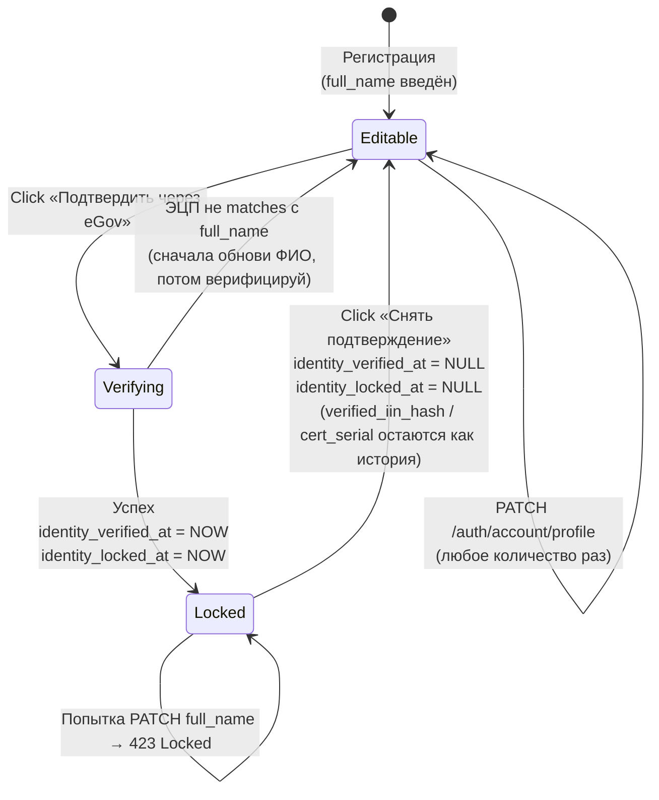

### ЭЦП-flow (детальный)

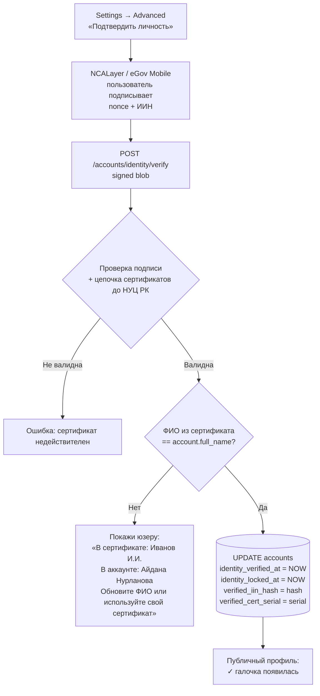

### «Снять подтверждение»

- Кнопка в `Settings → Advanced → Подтверждение личности`
- Двойное confirmation modal: «Это снимет ✓ с публичного профиля и разблокирует ФИО. Уверены?»
- Эффект:
  - `identity_verified_at = NULL`
  - `identity_locked_at = NULL`
  - `verified_iin_hash` — **остаётся** (история)
  - `verified_cert_serial` — **остаётся** (история)
  - Публичная страница: ✓ исчезает
- После этого: full_name снова редактируем; можно повторно пройти верификацию (если будет matches с новым ФИО)

### Что мы НЕ делаем

- **Не следим за сроком действия сертификата.** Один раз подтвердил → подтверждён, пока сам не снимет. Это сознательное упрощение (см. ответы на open questions).
- **Не запрещаем менять `display_name` бренда** — он отдельная сущность, не привязан к ФИО.
- **Не делаем верификацию обязательной** — это опциональная trust-фича.

### Каскад на удаление аккаунта

При hard-delete account:
- Удаляются accounts, providers, calendar_entries, telegram_accounts (связанные)
- Хеш ИИН в `verified_iin_hash` уходит вместе с записью — privacy clean

---

## 🌙 Авто-спячка профиля при долгой неактивности

> **Цель:** защитить клиентов от «мёртвых» профилей. Специалист пропал на 3 месяца — клиент не должен на него натыкаться в поиске.

### Триггер спячки

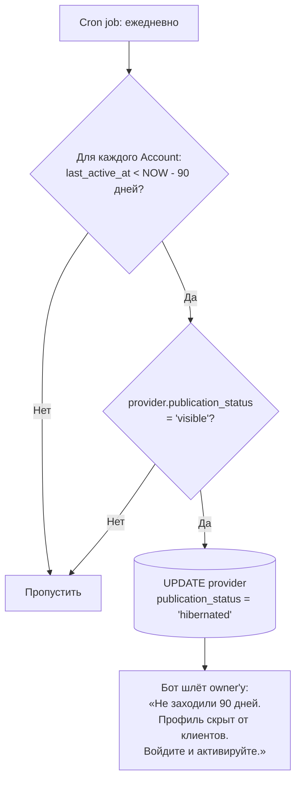

### Что обновляет `last_active_at`

- Любой `POST /telegram/mini/auth` с валидным initData
- Любой `GET /providers/me` с валидным session_token
- Любой `POST/PATCH` от owner'а к своему профилю/календарю
- **НЕ обновляет:** действия помощников (т.к. owner сам не появляется)

### Что значит `publication_status = 'hibernated'`

- Скрыт из `public_providers_search`
- `/p/<slug>` показывает: «Специалист сейчас не активен. Загляните позже.» (или похожее мягкое сообщение, не 404)
- Owner при следующем заходе видит баннер: **«Ваш профиль скрыт — клиенты вас не видят. Активировать?»**
- Кнопка «Активировать» → `publication_status = 'visible'` + `last_active_at = NOW`

### Активация = одно действие

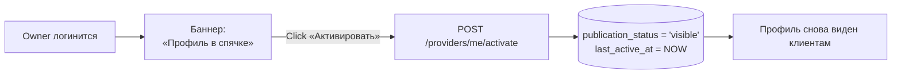

### Edge cases

| Сценарий | Поведение |
| --- | --- |
| Подписка trial и `last_active_at` старый — попадает под спячку? | **Нет.** Trial-период (первые 30 дней с регистрации) — освобождение от auto-hibernate. Даём время на setup. |
| Подписка expired И inactive | Профиль скрыт через `public_providers_search` (subscription check). `'hibernated'` не нужен, он overlaps. Cron-job не трогает expired-subscriptions. |
| Помощник активен, owner — нет | `last_active_at` обновляется только от owner'а. Помощник работает, профиль в спячку **уйдёт** через 90 дней. Это правильно: если owner не следит, профиль не «живой». |
| Owner активирует → снова уходит на 90 дней | Снова спячка. Цикл нормальный. |

### Что мы НЕ делаем

- Не удаляем данные при спячке. Только скрываем профиль.
- Не отменяем подписку. Юзер платит, но виден сам себе.
- Не предупреждаем заранее (за 7 дней до спячки) — добавится потом, если будет жалоба.

---

## 📊 Что упрощается в коде

### Удаляется

| Файл / модуль | Что |
| --- | --- |
| `apps/web/src/app/mini/overlays/MiniSwitchSheet.tsx` | Переключатель профилей — больше не нужен |
| `apps/web/src/app/mini/screens/MiniProfilesScreen.tsx` | Список профилей упрощается до одного «Мой профиль» |
| `apps/web/src/app/mini/screens/more/TransfersTool.tsx` | Передача профиля удаляется как механика |
| `apps/api/src/telegram/routes.ts` — transfer endpoints | `/transfer-request`, `/transfers/{id}/accept`, `/reject` |
| `supabase/migrations/.../transfer_*` (логически) | Таблица `transfer_requests` + связанная логика |
| `MiniMoreScreen` → `TransfersTool` маршрут | Убирается |
| `useMiniApp.ts` — multi-profile state | `activeIdx`, `switchActiveIdx`, `syncActiveProvider` — упрощаются до одного провайдера |
| `MiniTopBar` — chevron + counter `(1/3)` | Убирается, остаётся только статус |

### Упрощается

| Что | Как |
| --- | --- |
| `useMiniApp` | Вместо `Provider[]` — `Provider \| null`; меньше state, меньше callbacks |
| `MiniMoreScreen` | Меньше пунктов: нет «Передачи» |
| API `/providers/me` | Возвращает `provider` (не массив) |
| Onboarding Step 1 | Категория → массив категорий (1-5) |
| Аналитика | Один источник данных, опц. фильтр по категории |
| SEO для специалиста | Один URL = один авторитет, не дробится |

### Остаётся

- Account-level subscription (это правильное решение, не трогаем)
- TelegramAccounts (помощники) — расширяется: добавляется `categories_scope`
- Archive / Hard-delete профиля
- ActivityLog
- Все wire-типы, паттерны, lib/auth
- IntegrationsTool, TeamTool — но в TeamTool появляется UI выбора scope при invite

### Расширяется

| Что | Как |
| --- | --- |
| `TeamTool.tsx` (invite) | UI выбора scope: чипсы из категорий профиля + «все категории» |
| Calendar API | Фильтр записей по `category_tag` если у помощника scope задан; busy/free статус всем |
| Bot notifications | Дублирование action-уведомлений owner'у при действиях помощников |
| Revoke endpoint | Меняет поведение: DELETE row + анонимизация audit log |

---

## 🚦 План миграции (шаги)

### Этап 1: Подготовка БД (отдельная сессия)

**Миграция `028_single_profile_consolidation.sql`:**
1. Создать таблицу `provider_categories(provider_id, category_code, subcategory_code, sort_order)`
2. Для каждого Provider — мигрировать `primary_category` → одна строка в `provider_categories` с `sort_order=0`
3. Добавить колонку `calendar_entries.category_tag text` (nullable)
4. Добавить колонку `telegram_accounts.categories_scope text[]` (nullable; NULL = все категории)
5. Удалить таблицу `transfer_requests` и связанные триггеры
6. Удалить колонку `providers.primary_category` и `primary_subcategory` (после миграции данных)
7. Добавить UNIQUE constraint на `providers.account_id` (через `provider_accounts` или прямой FK — решить)
8. Adjust activity_log: разрешить `actor_telegram_account_id` быть NULL после revoke; `actor_name` остаётся текстовым полем (уже есть)

**Миграция `029_account_identity.sql` (ФИО + ЭЦП):**
1. `ALTER COLUMN accounts.full_name SET NOT NULL` — backfill для существующих, потом NOT NULL
2. Добавить колонки `accounts.identity_verified_at timestamptz`, `identity_locked_at timestamptz`, `verified_iin_hash text`, `verified_cert_serial text`
3. Trigger или app-level проверка: при попытке update `accounts.full_name` если `identity_locked_at IS NOT NULL` → reject
4. Удалить колонку `providers.is_verified` — публичный ✓ теперь берётся из `accounts.identity_verified_at`

**Миграция `030_account_activity.sql` (last_active + hibernation):**
1. Добавить колонку `accounts.last_active_at timestamptz NOT NULL DEFAULT NOW()`
2. Добавить значение `'hibernated'` в enum `publication_status` (или check constraint, как сейчас)
3. Index на `accounts(last_active_at)` для быстрого cron-запроса
4. Обновить view `public_providers_search` — исключить `'hibernated'`

### Этап 2: Backend (отдельная сессия)

**Provider/Account:**
- Переписать `providers/repositories.ts`: `findProvidersByAccountId` → `findProviderByAccountId` (single)
- Удалить endpoints: `/transfer-request`, `/transfers/*`
- Обновить `providers/routes.ts`: `/providers/me` возвращает `provider` (не `providers[]`)
- API эндпоинт для категорий: `PATCH /providers/{id}/categories` (массив)
- Endpoint активации после спячки: `POST /providers/me/activate`

**Помощники:**
- Calendar API: фильтрация записей для assistant по `categories_scope`; busy/free статус — полный, детали — только в scope
- TeamTool API: `POST /providers/{id}/assistant-invite` принимает `{ scope?: string[] }`
- Revoke endpoint: DELETE telegram_accounts row + анонимизация activity_log
- Новый endpoint: `POST /telegram/mini/assistant/leave` (помощник сам уходит) — то же поведение
- Bot notification logic: при write-операциях помощника — копия в owner telegram (расширить `notification_jobs` или inline в endpoint)

**ФИО + ЭЦП:**
- `auth/account/profile` PATCH: проверка locked состояния, ответ 423 Locked при попытке менять `full_name`
- Новый endpoint: `POST /accounts/identity/verify` — валидация ЭЦП-подписи через bouncycastle/node-forge, цепочка до НУЦ РК, matches ФИО
- Новый endpoint: `POST /accounts/identity/revoke` — снять подтверждение (clear identity_verified_at + identity_locked_at, keep iin_hash и cert_serial)
- Update `auth/me` response: добавить `identity_verified_at`, `identity_locked_at`
- Update публичный `GET /public/providers/<slug>`: вернуть `account.identity_verified_at` как `identity_verified` boolean

**Активность + спячка:**
- Middleware: на каждый authenticated request обновлять `accounts.last_active_at = NOW()` (но только если прошло >5 минут с предыдущего апдейта — throttling)
- Cron job: `POST /internal/jobs/check-hibernation` — runs daily, marks providers as 'hibernated' если account.last_active_at < NOW - 90 дней AND provider.publication_status = 'visible' AND account.subscription.status != 'expired' AND account.created_at < NOW - 30 дней (защита trial)
- При marking → создать `notification_jobs` запись на «profile_hibernated_reminder» для бота

**Регистрация (фиксация принципа):**
- `POST /telegram/mini/account` — единственное место, где создаётся `accounts` row. Проверить, что нет других точек создания.

### Этап 3: Mini App UI (отдельная сессия)

**Multi-profile удаление:**
- Удалить `MiniSwitchSheet.tsx`, `TransfersTool.tsx`
- Упростить `MiniProfilesScreen.tsx` (только текущий профиль)
- Упростить `useMiniApp` (state, return shape — Provider | null вместо []`)
- Упростить `MiniTopBar` (убрать chevron/counter)
- Обновить `MoreScreen` items: удалить «Передачи»

**Помощники:**
- `TeamTool` — добавить выбор scope при invite (чипсы категорий), отображение текущего scope для каждого помощника, кнопка изменить scope
- `CalendarMonthView / CalendarDayView`: для записей вне scope — показывать «занято · не вашего направления» без деталей
- `MiniAnalyticsScreen`: для помощника — фильтр данных по `categories_scope`
- Для помощников: новая кнопка «Покинуть команду» в `MoreScreen` (только для assistant-role)

**ФИО + ЭЦП:**
- `MiniGuestGate`: label ФИО + helper text про подтверждение
- `SettingsTool` → Аккаунт → ФИО: disabled с tooltip при `identity_locked_at IS NOT NULL`
- `SettingsTool` → Advanced → новый «Подтверждение личности» tool: статус + кнопка «Подтвердить через eGov» (NCALayer integration или ссылка на eGov Mobile для QR-подписи) / «Снять подтверждение» с confirm
- Public `/p/<slug>`: badge «✓ Подтверждённый специалист» из API response поля `identity_verified`

**Спячка:**
- При логине: если `provider.publication_status === 'hibernated'` → большой баннер сверху всех экранов «Профиль скрыт от клиентов. Активировать?» + кнопка
- В `MoreScreen` пункт «Статус профиля» подсвечивается красным/жёлтым при спячке

### Этап 4: Web onboarding + dashboard (отдельная сессия)

- `Step1Basics.tsx`: категория → массив (1-5 чипсами)
- `dashboard/provider/edit/page.tsx`: то же
- `dashboard/page.tsx`: одна карточка «Мой профиль»

### Этап 5: Документация и тесты

- Обновить `CURRENT.md` целиком
- Обновить `entities.md` — новая ER-схема
- Удалить multi-profile mentions из `flow-specialist.md` (или просто оставить как историю)
- Адаптировать тесты

---

## ⚠️ Открытые вопросы

1. **`category_tag` в `calendar_entries` — обязательный или опциональный?**
   - Опциональный = проще, но scope-фильтрация помощников теряет смысл для записей без тега
   - Обязательный = scope работает чётко, но в moment записи кто-то может не помнить, какая категория
   - **Моё мнение:** опциональный для owner'а (он видит всё), но **обязательный для помощника** — когда Алия создаёт запись, тег автоматически = её scope (если scope=DJ → тег=DJ). Если у помощника scope=[DJ, Тамада] (2 категории) — выбор перед сохранением.

2. **Что видит помощник для записей вне scope?**
   - **Решение** (по обсуждению с владельцем): видит статус **busy/free**, не видит детали (клиент, цена, заметки). Подпись «занято · не вашего направления». Это conflict-prevention без раскрытия чужих данных.

3. **Может ли помощник иметь scope = «все»?**
   - **Да.** Если scope = NULL — помощник видит весь профиль (как owner, кроме edit профиля и управления командой). Это «универсальный помощник».

4. **Slug при «миграции»?**
   - У Айданы было `/p/aidana-dj` и `/p/aidana-tamada`
   - Какой оставить? Создать новый `/p/aidana`?
   - **Сейчас:** пользователей нет — не вопрос. Делаем чистый `/p/<slug>` на каждый Account.

5. **Что с пробным периодом, если у пользователя было 2 профиля?**
   - Подписка уже account-level — не меняется, **не трогаем**.

6. **Брендирование: что, если у Айданы реально 2 разных бренда (DJ Spektr и Айдана Тамада)?**
   - Сейчас она бы сделала 2 профиля
   - В новой модели: один Provider с display_name=«Айдана Нурланова», в bio упоминает «DJ Spektr · Тамада»
   - Или: позволить ОДИН доп. brand-нейм (alternative_name?) — но это уже усложнение
   - **Моё мнение:** не добавлять alternative_name. Если у человека действительно 2 разных бренда — это уже 2 разных бизнеса = 2 разных Account-а.

7. **Что если owner меняет категории профиля, и `categories_scope` помощника содержит категорию, которой больше нет?**
   - Вариант A: автоматически удалить эту категорию из scope; если scope пустой → помощник теряет доступ
   - Вариант B: warning owner'у «У Алии scope=[DJ], но DJ удалена. Обновите scope»
   - **Моё мнение:** Вариант A с уведомлением. Owner и помощник получают сообщение в боте.

8. **Можно ли помощнику дать scope, шире чем нужно? (например, scope=[DJ, Тамада, Фото], но у профиля только DJ и Тамада)**
   - **Решение:** валидация на API — нельзя добавить scope-категорию, которой нет в `provider_categories`.

---

## 🟢 Зелёный свет от тебя — и я готов начать

Если согласен с направлением — следующая моя задача:
- **Сессия 1:** написать миграцию БД + обновить API repositories (Этапы 1–2). Не трогаю UI пока, чтобы не сломать сразу всё.
- **Сессия 2:** mini-app UI (Этап 3).
- **Сессия 3:** web onboarding/dashboard + полировка (Этапы 4–5).

Если что-то в плане кажется неверным — пиши, обсудим. Особенно интересно мнение по «открытым вопросам» выше.
