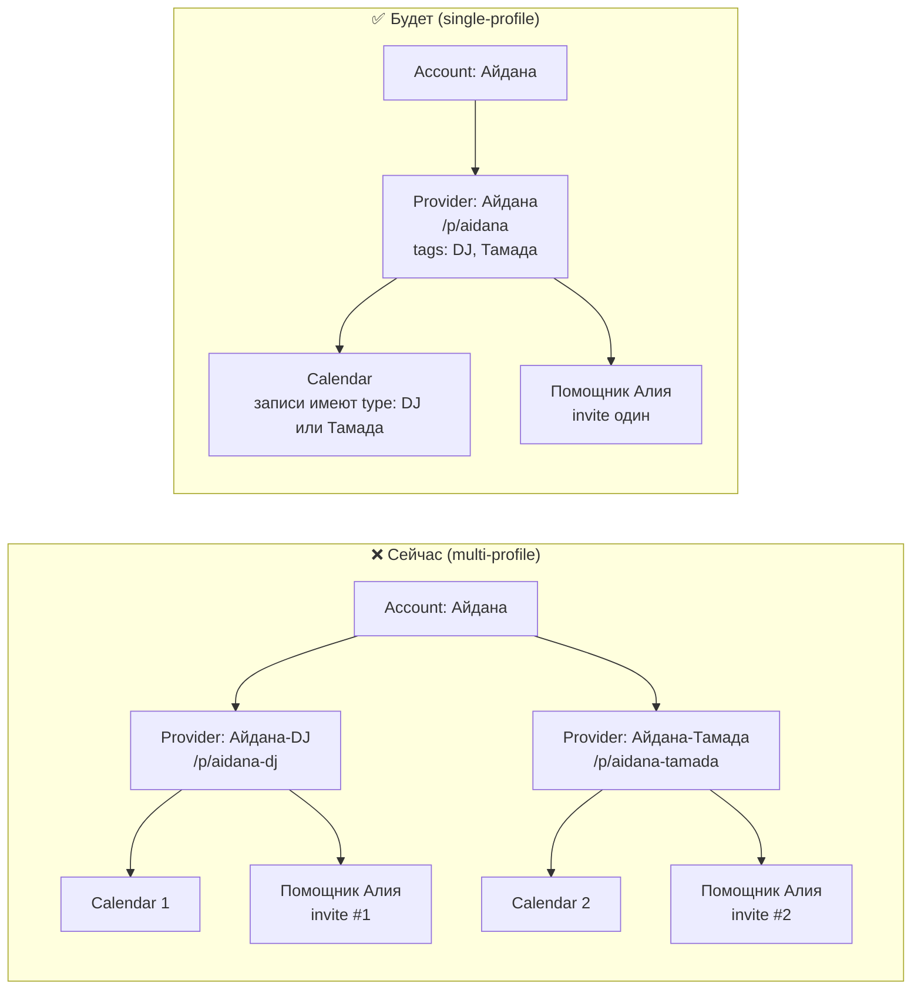
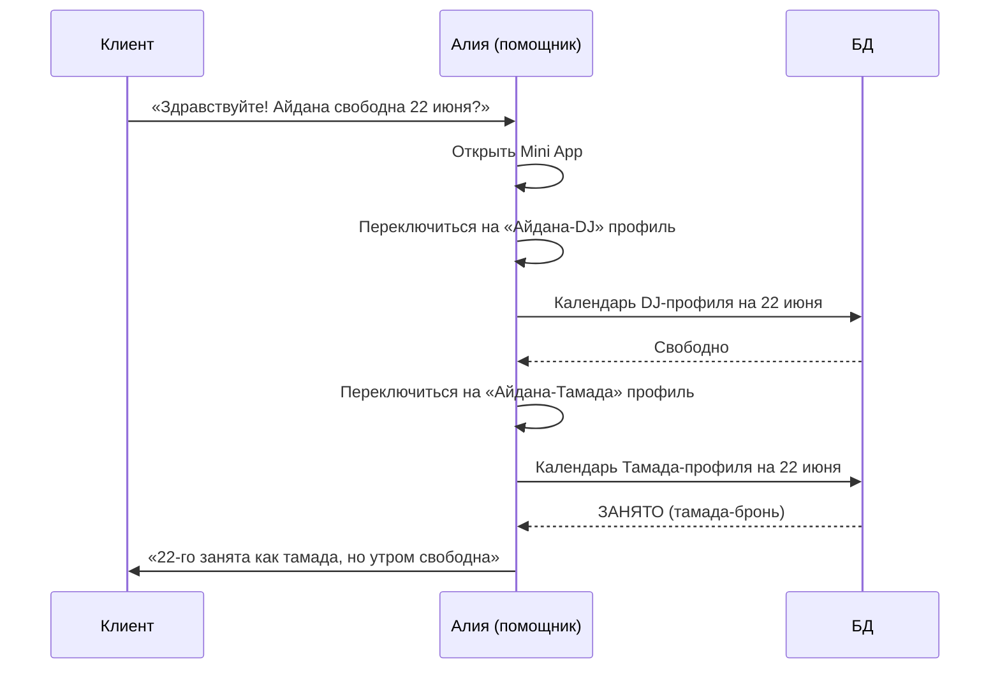
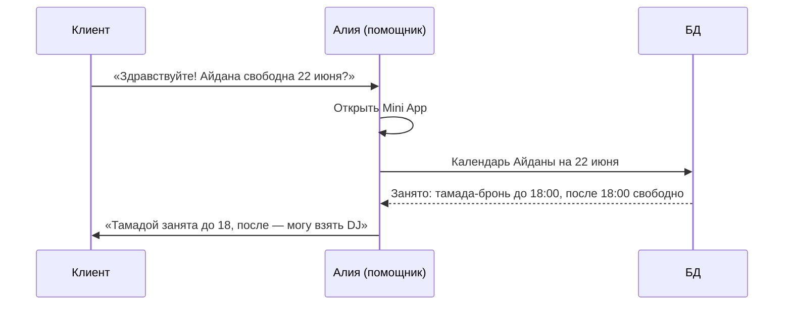
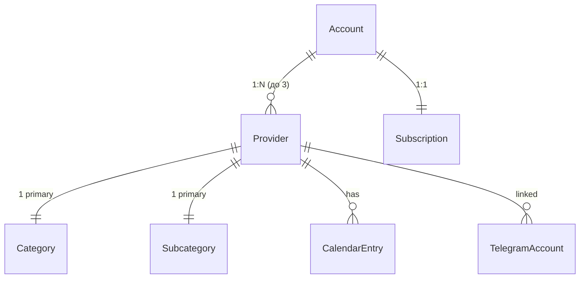
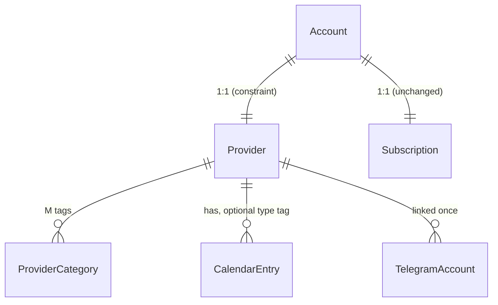
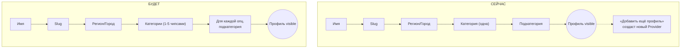
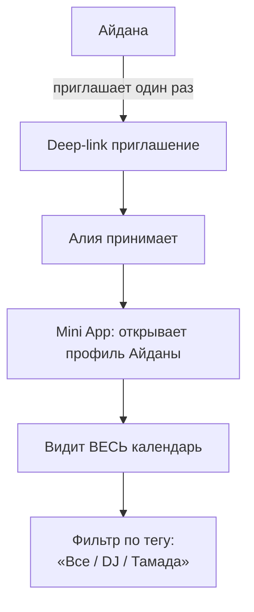

# 📋 Proposal: 1 специалист = 1 профиль (мульти-категория)

> **Статус:** на обсуждении. Не начата реализация. Окно открыто — пользователей пока нет.

## TL;DR

Убираем multi-profile (1 Account → много Providers). Один человек = один Provider с массивом категорий и одним календарём. Помощники приглашаются один раз, видят всю работу специалиста.



---

## 🎬 Конкретный сценарий: Айдана + помощница Алия

### Сейчас (4 шага со сложностями)



**Проблема:** Алия должна **дважды переключиться**, помнить о двух календарях, и физически Айдана **не может быть** одновременно DJ и тамадой — но в системе у неё 2 разных календаря.

### Будет (1 шаг)



---

## 🧬 Модель данных: что меняется

### Сейчас



### Будет



### Колонки/таблицы

| Что | Сейчас | Будет |
| --- | --- | --- |
| Связь Account ↔ Provider | `provider_accounts(account_id, provider_id)` — M:N | Колонка `providers.account_id` UNIQUE — 1:1 |
| Категория | `providers.primary_category` + `primary_subcategory` | Новая таблица `provider_categories(provider_id, category_code, subcategory_code, sort_order)` |
| Календарная запись | `calendar_entries(...)` | Та же + опц. колонка `category_tag` (для аналитики) |
| Передача профиля | `transfer_requests` таблица + flow | **Удалена** |
| Архив профиля | работает | работает (без изменений) |
| Hard-delete профиля | работает | работает (без изменений) |

---

## 🧑‍🍳 Что видит специалист (Айдана)

### Onboarding (Step 1) — сейчас vs будет



### Mini App для Айданы

**Сейчас:**
```
┌─────────────────────────────────┐
│  ⚫ Айдана-DJ (1/2) · виден  ⌄ │ ← переключатель!
├─────────────────────────────────┤
│  [Профили] [Кален.] [Анал.] ⋯  │
├─────────────────────────────────┤
│  Список профилей:               │
│   • Айдана-DJ        [править] │
│   • Айдана-Тамада    [править] │
│   • + Добавить (макс 3)         │
└─────────────────────────────────┘
```

**Будет:**
```
┌─────────────────────────────────┐
│  ⚫ Айдана · виден клиентам    │ ← без переключателя
├─────────────────────────────────┤
│  [Профиль] [Кален.] [Анал.] ⋯  │
├─────────────────────────────────┤
│  Айдана                         │
│  🎧 DJ · 🎤 Тамада              │ ← категории как чипсы
│  [Изменить категории]           │
│  [Фото] [Контакты] [Ссылка]    │
└─────────────────────────────────┘
```

### Создание записи в календаре

**Сейчас:**
1. Выбрать «какой профиль»
2. Указать «занято» 22 июня
3. (Календарь только этого профиля)

**Будет:**
1. Указать «занято» 22 июня
2. Опц. тег: «как DJ» / «как тамада» / без тега
3. (Календарь общий)

---

## 🙋 Что видит клиент

### Профиль `/p/aidana` (одна страница)

```
┌─────────────────────────────────────┐
│  ← Назад             ↗ Поделиться  │
├─────────────────────────────────────┤
│  [Фото-обложка]                     │
│                                     │
│  Айдана Нурланова  ✓ Верификация   │
│  📍 Алматы                          │
│  🎧 DJ  ·  🎤 Тамада                │ ← обе категории
│                                     │
│  [📲 Контакты]                      │
├─────────────────────────────────────┤
│  Услуги                             │
│  • DJ на свадьбу — от 100 000 ₸    │
│  • Тамада на свадьбу — от 80 000 ₸ │
├─────────────────────────────────────┤
│  📅 Календарь                       │
│   22 июня — занято · 🎤 тамада      │ ← опц. показывать чем именно
│   23 июня — свободно                │
└─────────────────────────────────────┘
```

### В поиске

- Клиент ищет `cat=DJ` → Айдана появляется
- Клиент ищет `cat=Тамада` → Айдана появляется
- Один URL `/p/aidana`, два разных trigger'а в поиске
- В сниппете: «🎧 DJ · 🎤 Тамада» — клиент видит, что специалист универсальный

---

## 🧑‍🤝‍🧑 Что видит помощница (Алия)



**Что Алия может:**
- Видеть все брони (с тегом или без)
- Создавать новые записи (с тегом или без)
- Видеть аналитику профиля (общую + раздельную по тегам)
- НЕ может: править фото/категории, передавать профиль, удалять

---

## 📊 Что упрощается в коде

### Удаляется

| Файл / модуль | Что |
| --- | --- |
| `apps/web/src/app/mini/overlays/MiniSwitchSheet.tsx` | Переключатель профилей — больше не нужен |
| `apps/web/src/app/mini/screens/MiniProfilesScreen.tsx` | Список профилей упрощается до одного «Мой профиль» |
| `apps/web/src/app/mini/screens/more/TransfersTool.tsx` | Передача профиля удаляется как механика |
| `apps/api/src/telegram/routes.ts` — transfer endpoints | `/transfer-request`, `/transfers/{id}/accept`, `/reject` |
| `supabase/migrations/.../transfer_*` (логически) | Таблица `transfer_requests` + связанная логика |
| `MiniMoreScreen` → `TransfersTool` маршрут | Убирается |
| `useMiniApp.ts` — multi-profile state | `activeIdx`, `switchActiveIdx`, `syncActiveProvider` — упрощаются до одного провайдера |
| `MiniTopBar` — chevron + counter `(1/3)` | Убирается, остаётся только статус |

### Упрощается

| Что | Как |
| --- | --- |
| `useMiniApp` | Вместо `Provider[]` — `Provider \| null`; меньше state, меньше callbacks |
| `MiniMoreScreen` | Меньше пунктов: нет «Передачи» |
| API `/providers/me` | Возвращает `provider` (не массив) |
| Onboarding Step 1 | Категория → массив категорий (1-5) |
| Аналитика | Один источник данных, опц. фильтр по категории |
| SEO для специалиста | Один URL = один авторитет, не дробится |

### Остаётся

- Account-level subscription (это правильное решение, не трогаем)
- TelegramAccounts (помощники) — но скоп упрощается: один Provider = один контекст
- Archive / Hard-delete профиля
- ActivityLog
- Все wire-типы, паттерны, lib/auth

---

## 🚦 План миграции (шаги)

### Этап 1: Подготовка БД (отдельная сессия)

**Миграция `028_single_profile_consolidation.sql`:**
1. Создать таблицу `provider_categories(provider_id, category_code, subcategory_code, sort_order)`
2. Для каждого Provider — мигрировать `primary_category` → одна строка в `provider_categories` с `sort_order=0`
3. Добавить колонку `calendar_entries.category_tag` (nullable)
4. Удалить таблицу `transfer_requests` и связанные триггеры
5. Удалить колонку `providers.primary_category` и `primary_subcategory` (после миграции данных)
6. Добавить UNIQUE constraint на `providers.account_id` (через `provider_accounts` или прямой FK — решить)

### Этап 2: Backend (отдельная сессия)

- Переписать `providers/repositories.ts`: `findProvidersByAccountId` → `findProviderByAccountId` (single)
- Удалить endpoints: `/transfer-request`, `/transfers/*`
- Обновить `providers/routes.ts`: `/providers/me` возвращает `provider` (не `providers[]`)
- API эндпоинт для категорий: `PATCH /providers/{id}/categories` (массив)

### Этап 3: Mini App UI (отдельная сессия)

- Удалить `MiniSwitchSheet.tsx`, `TransfersTool.tsx`
- Упростить `MiniProfilesScreen.tsx` (только текущий профиль)
- Упростить `useMiniApp` (state, return shape)
- Упростить `MiniTopBar` (убрать chevron/counter)
- Обновить `MoreScreen` items: удалить «Передачи»

### Этап 4: Web onboarding + dashboard (отдельная сессия)

- `Step1Basics.tsx`: категория → массив (1-5 чипсами)
- `dashboard/provider/edit/page.tsx`: то же
- `dashboard/page.tsx`: одна карточка «Мой профиль»

### Этап 5: Документация и тесты

- Обновить `CURRENT.md` целиком
- Обновить `entities.md` — новая ER-схема
- Удалить multi-profile mentions из `flow-specialist.md` (или просто оставить как историю)
- Адаптировать тесты

---

## ⚠️ Открытые вопросы

1. **`category_tag` в `calendar_entries` — обязательный или опциональный?**
   - Опциональный = проще, но аналитика «сколько DJ-броней» неполная
   - Обязательный = чище данные, но в moment записи кто-то может не помнить, какая категория
   - **Моё мнение:** опциональный. Большинство специалистов работают в одной категории «по умолчанию».

2. **Slug при «миграции»?**
   - У Айданы было `/p/aidana-dj` и `/p/aidana-tamada`
   - Какой оставить? Создать новый `/p/aidana`?
   - **Сейчас:** пользователей нет — не вопрос. Делаем чистый `/p/<slug>` на каждый Account.

3. **Что с пробным периодом, если у пользователя было 2 профиля?**
   - Подписка уже account-level — не меняется, **не трогаем**.

4. **Брендирование: что, если у Айданы реально 2 разных бренда (DJ Spektr и Айдана Тамада)?**
   - Сейчас она бы сделала 2 профиля
   - В новой модели: один Provider с display_name=«Айдана Нурланова», в bio упоминает «DJ Spektr · Тамада»
   - Или: позволить ОДИН доп. brand-нейм (alternative_name?) — но это уже усложнение
   - **Моё мнение:** не добавлять alternative_name. Если у человека действительно 2 разных бренда — это уже 2 разных бизнеса = 2 разных Account-а.

---

## 🟢 Зелёный свет от тебя — и я готов начать

Если согласен с направлением — следующая моя задача:
- **Сессия 1:** написать миграцию БД + обновить API repositories (Этапы 1–2). Не трогаю UI пока, чтобы не сломать сразу всё.
- **Сессия 2:** mini-app UI (Этап 3).
- **Сессия 3:** web onboarding/dashboard + полировка (Этапы 4–5).

Если что-то в плане кажется неверным — пиши, обсудим. Особенно интересно мнение по «открытым вопросам» выше.
